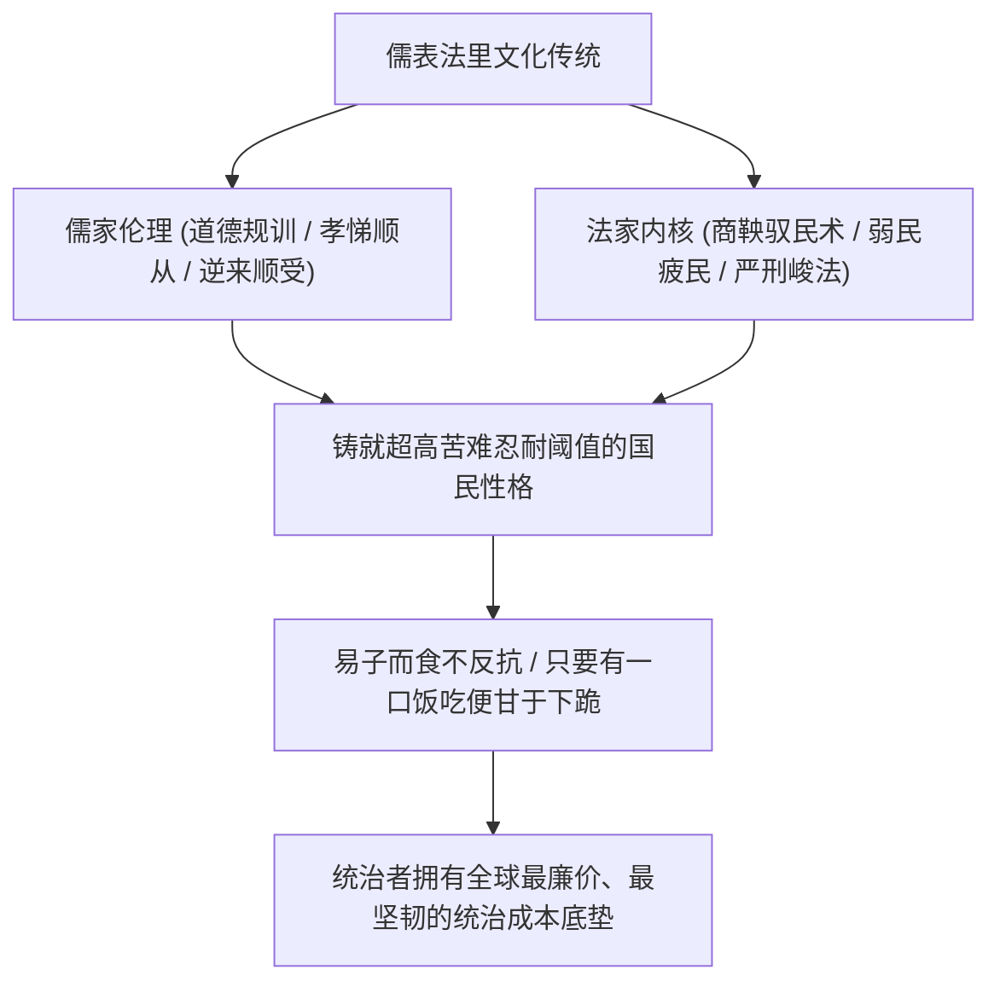

百年以来，常有知识分子沉痛发问：“大清亡了一百多年，为什么专制的阴魂始终不散？”

其实答案极其冷酷而直白：**清朝根本没有亡，很多人脑袋上的无形辫子一直都在，甚至比以往扎得更紧。**

中国人骨子里的顺从性、对绝对权力的膝跳式敬畏、以及对极度苦难的惊人耐受阈值，构成了人类文明史上最坚固的统治土壤。当两千年“儒表法里”的法家驭民术，遇上数亿高清摄像头、AI 人脸识别、大数据户籍联网等现代高科技时，国家机器的控制效率不仅没有被所谓“高能耗账单”拖垮，反而进化出了全球成本最低、压迫感最强、最不可能被动摇的超稳定极权结构。

---

### 一、 儒表法里的文化基因：极高耐受阈值的顺民底盘

商鞅在两千多年前就将法家驭民的核心秘诀总结得淋漓尽致——**弱民、疲民、贫民、辱民**。这套冷酷的驭民骨架，在历朝历代披上了一层儒家“君臣父子、忠孝仁义”的道德温情外衣，成功将庞大的人口驯化为互害、互猜、且极度耐压的顺民体系：



1. **世界上最耐压的国民基础**：
   - 三年自然灾害、十年文革动乱，底层百姓在极端苦难面前展现出的不是揭竿而起，而是默默承受与“好死不如赖活着”的犬儒生存哲学；
   - 只要给一口稀饭喝，普通人就会选择“忍”和“熬”。这种超高的生存耐受阈值，使得统治者不需要像西方国家那样提供昂贵的福利去收买选民，可以用最低的成本度过任何经济萧条；
2. **“代价就是人民”的统治自觉**：
   - 官方从来不怕所谓“改革的阵痛”或“政策的代价”，因为在儒表法里的伦理框架下，**人民生来就是被消耗、被转嫁成本的天然耗材**；
   - 无论宏观上面临多大的财政窟窿，只要调动国家机器向下压榨，顺民不仅不会反抗，反而会在内部相互竞争谁更顺从、谁更能吃苦。

---

### 二、 数字天网与现代科技：法家统治术的终极神装

西方自由派学者常天真地认为“数字化监控太贵了，电费与服务器会吃垮财政”。这种书生论调完全无视了中国高科技极权机器的实操杀伤力：

```text
+-------------------------------------------------------------------------+
|                  传统清朝控制 vs 现代数字天网控制对比                   |
+-------------------+-----------------------------------------------------+
| 比较维度          | 清朝衙役与保甲制              | 现代"AI + 天网 + 购票风控"          |
+-------------------+-------------------------------+---------------------+
| 响应时效          | 依靠快马传书，以天/周为单位   | 毫秒级抓取比对，秒级联动锁定        |
+-------------------+-------------------------------+---------------------+
| 物理活动范围      | 靠关卡路引，仍有山林死角逃亡  | 高铁/飞机/长途车全闭环，重点人插翅难飞|
+-------------------+-------------------------------+---------------------+
| 基层动员成本      | 地方宗族有阻力，容易官逼民反  | 算法自动封禁，基层机器化执行，无情冷酷|
+-------------------+-------------------------------+---------------------+
| 反抗苗头遏制      | 形成集会聚众后才派兵镇压      | 微信群聊/买票环节秒级扼杀在萌芽状态 |
+-------------------+-------------------------------+---------------------+
```

- **连高铁都坐不了，拿什么反抗？**
  - 数亿个高清摄像头日夜不休，AI 人脸识别在几十毫秒内完成全库检索；
  - 重点上访人员、异见人士的身份证一旦靠近公共交通枢纽，闸机瞬间亮起红灯报警锁死，连县城都走不出去；
  - 根本不需要等到矛盾激化成群体事件，在萌芽阶段，大数据的购票风控与户籍联动系统就已经把人的双脚彻底切断；
- **边际成本无限趋近于零**：
  - 一套成熟的安防算法与大数据模型开发完成后，部署到全省全国，边际调用成本只是微不足道的电费；
  - 辅警、网格员与安检员拿着几千块钱的极低工资，在严酷的就业竞争下拼命争抢这份体制边缘的饭碗，执行起来比任何人都要积极。所谓“财政吃不消高科技维稳”，完全是对工业化规模效应的无知。

---

### 三、 破除伪命题：“中国不需要原创，抄的成本最低”

知识界常拿“专制压抑创造力、逼不出芯片”来唱衰中国，这也是一个典型的伪命题：


1. **后发优势的终极实用主义**：
   - 为什么要花费几十年、耗资数千亿去试错从 0 到 1 的原始创新？在高度全球化的技术积累面前，逆向工程、技术转让、商业刺探与快速仿制，永远是成本最低、收益最快的终南捷径；
   - 从高铁、核电到面板、新能源车、光伏，中国凭借数以千万计的廉价工程师大军，硬生生把西方几十年高昂研发成本砸出来的技术，用最低的成本消化并打成白菜价；
2. **“信息茧房”的马基雅维利算计**：
   - 别以为最高决策层真的“全瞎全聋”。大一统帝国的核心官僚全都是从基层政治大熔炉里一步步踩着别人肩膀爬上来的，没有人比他们更懂基层的弯弯绕绕；
   - 他们对一切心知肚明，**“装着不知道”本身就是最高明的政治统治艺术**。只要大局在控、政权稳固，允许底下人报喜不报忧，正是在官僚体系内部维系平衡与忠诚度的必要润滑剂。

正如翟东升在《中国为什么有前途》（机械工业出版社，2019年）中所分析的，庞大的人口腹地、梯次配套的产业纵深以及庞大的工程师红利，赋予了中国在应用型技术迭代与全要素生产率快速平替上的惊人韧性。西方以为封锁几款先进制程芯片就能让中国停摆，殊不知在成熟工艺与全门类制造领域，中国早已具备无懈可击的替代与自愈能力。

---

### 四、 结语

不要指望这套系统会因为所谓的“熵增”或“年轻人躺平”而自发崩解：

**只要心中的辫子还在，人民甘当代价，国家机器手里的高科技皮鞭就永远不会生锈。**

在两千年成熟驭民术与现代数字化天网的加持下，统治者拥有着世界上最高效的控制杠杆与最低廉的服从成本。那些期待帝国从内部自发解体的人，终将发现自己低估了这片土地上专制基因的深厚惯性。

---

### 参考文献与延伸阅读

1. 温铁军. 新中国十次周期性经济危机[M]. 北京: 东方出版社, 2013.
2. 翟东升. 中国为什么有前途[M]. 3版. 北京: 机械工业出版社, 2019.
3. 翟东升. 货币、权力与人: 全球货币与金融体系的民本主义政治经济学[M]. 北京: 中国社会科学出版社, 2019.