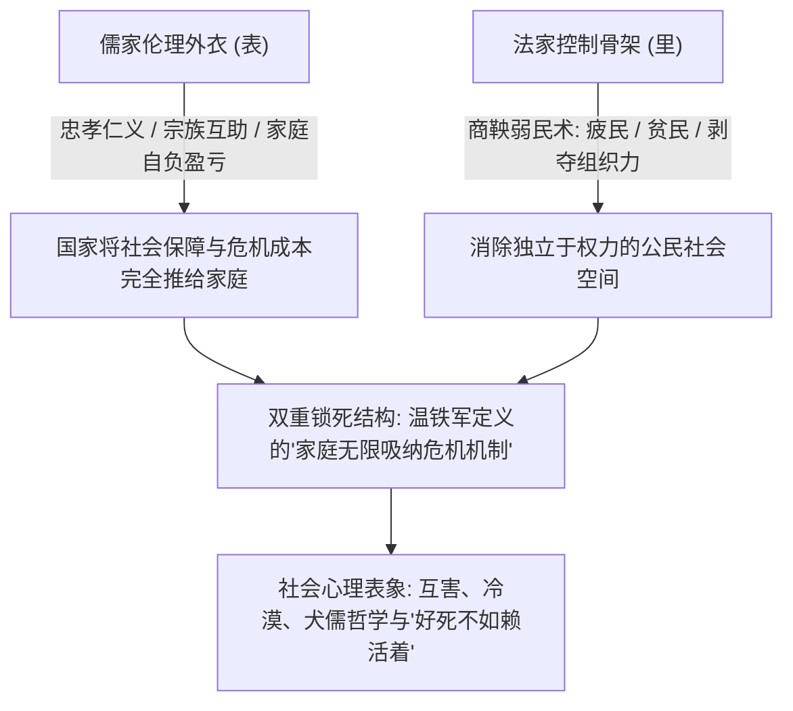
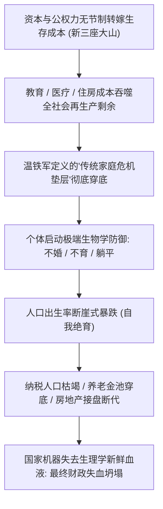
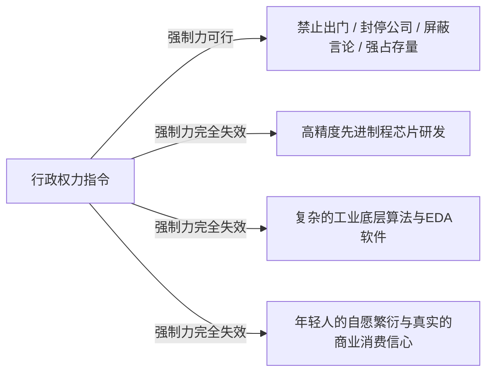

从鲁迅写《阿Q正传》、《狂人日记》，到柏杨痛陈《丑陋的中国人》，百年来知识界常发出沉痛的慨叹：**清朝虽然亡了，但很多人脑后的无形辫子、心里的奴性、对绝对权力的膝跳式下跪，似乎从来没有被真正割除。**

不可否认，从“文化基因”与臣民心理的尺度来看，中国两千年来在驯化臣民的制度技术上确实登峰造极：商鞅的法家驭民术（弱民、疲民、贫民、辱民）被巧妙地披上了一层儒家“君臣父子、孝悌忠义”的温情面纱，将庞大人口塑造成了一个个孤立、互害、极度耐压的顺民个体。

然而，如果结合温铁军在解构新中国十次周期性危机时对“传统小农家庭作为危机无底线吸纳器”的分析，便会发现：**这套驯化术之所以能维持数千年，并非单纯靠思想灌输，而是依托于传统家庭自给自足的经济垫层**。

当现代资本化与激进城市化将家庭彻底撕碎为高负债的原子化个体时，这套维系千年的控制机制便遭遇了不可逆的物理与代际反噬。

---

### 一、 “儒表法里”的微观承载体：传统家庭作为成本吸纳器

两千年来帝王专制术的核心底座从来不是单纯的暴力，而是极其冷酷的法家控制逻辑，借由儒家伦理在微观家庭内部实现了成本转嫁：



```text
+-------------------------------------------------------------------------+
|                  商鞅法家驭民术与家庭成本吸纳机制对比                   |
+-------------------+-----------------------------------------------------+
| 法家原始教条      | 历史实践机制                  | 现代社会投射表现    |
+-------------------+-------------------------------+---------------------+
| 弱民 (民强国弱)   | 消除中间宗族自治与民间组织    | 垄断一切社会结社，消灭公民社会空间  |
+-------------------+-------------------------------+---------------------+
| 疲民 (使民无暇)   | 繁重劳役赋税，让民疲于奔命    | 高房价高物价，延长劳动时间维持生存压力|
+-------------------+-------------------------------+---------------------+
| 贫民 (家无积蓄)   | 盐铁官营，剥夺民间资本沉淀    | 行政垄断核心要素，隐性通胀稀释私有储蓄|
+-------------------+-------------------------------+---------------------+
| 辱民 (使其无尊严) | 严刑峻法，消解个体独立人格    | 权力任意裁量，特权面前普通人尊严归零|
+-------------------+-------------------------------+---------------------+
```

温铁军在分析中国多次化解经济危机的经验时明确指出：中国传统小农家庭是一个**“非资本主义核算、具有无限弹性自我剥削能力的微观避风港”**。
- 无论国家在宏观上遭遇多么严重的财政破产、赤字或外债危机（如1960年三年困难、1968年工业停摆、1979年大批知青返城待业），国家机器都可以凭借“返乡、探亲、家庭自养”的名义，将数千万青年的生存成本直接甩给农村的家庭和土地消化；
- 在儒家“孝道”与家庭伦理的规训下，中国底层家庭默默吞下了一切制度成本，没有工会罢工，没有街头抗议。这种极其隐秘的转嫁通道，构成了传统专制体系最舒适的统治温床。

---

### 二、 现代社会的不可逆性：为什么大棒在工业文明中失效？

很多人以为，有了数亿个高清摄像头、AI 人脸识别、大数据户籍联网和出行限制风控，现代专制大棒的威慑力远超清朝。

然而，**现代高科技极权机器的维持成本，在物理能耗上高出清朝一万倍**。当现代社会从传统农耕家庭转变为高度城市化的人口结构时，传统的驯化底牌遭到了不可逆的解构：

```text
+-------------------------------------------------------------------------+
|                  农耕小农家庭 vs 现代城市化原子家庭对比                 |
+-------------------+-----------------------------------------------------+
| 比较维度          | 传统农耕家庭                  | 现代城市化原子家庭  |
+-------------------+-------------------------------+---------------------+
| 社会组织结构      | 聚族而居，自给自足，内部吸纳失业| 核心家庭原子化，完全依赖工资现金流  |
+-------------------+-------------------------------+---------------------+
| 现代系统依赖      | 仅需土地与雨水，断水断电无所谓| 依赖电网、自来水、燃气、冷链与移动支付|
+-------------------+-------------------------------+---------------------+
| 合法性心理契约    | "天命难违"，只要饿不死即可    | "发展主义契约"：生活必须一年比一年好|
+-------------------+-------------------------------+---------------------+
| 危机反抗形式      | 逼急了揭竿而起 (陈胜吴广)     | 非暴力不合作：断供、断代、不消费、躺平|
+-------------------+-------------------------------+---------------------+
```

现代城市是一个极度脆弱的复杂生态系统。现代人被高度分工捆绑在写字楼与住宅小区中，无法像封建农民那样退回自然经济自给自足。

更关键的是：**过去四十年民众之所以容忍严苛管制与特权寻租，核心在于“发展主义契约”**——经济在高速增长，个人努力还能分到一杯羹，资产还在升值。一旦蛋糕不再做大，失业青年增多、资产腰斩、考公无门，儒家的道德叙事便瞬间被视为伪善谎言，法家的压制便彻底赤裸相对。

---

### 三、 顺民的终极非暴力反抗：少子化与“自我绝育”

在绝对压倒性的暴力与监控网络面前，如果顺民真的彻底丧失了抵抗意志，是否意味着帝国能够长生不老？

历史最残酷的讽刺恰恰在于：**当公权力和资本过度抽取了家庭再生产的全部剩余时，顺民在无法反抗时采取的终极生存策略，是“自我绝育”**。



1. **从“不孝有三”到生理学灭绝**：
   - 清朝的农民即便再穷，头脑里依然深植“不孝有三，无后为大”的宗族教条，再苦也要生下子嗣当劳力；
   - 现代城市青年连最底层的繁衍本能都被生活压力彻底掐灭。温铁军曾指出，过去四十年为了高速城市化，国家通过“土地资本化”把几代普通家庭的终身储蓄沉淀为高额土地出让金与房贷；
   - 面对“孩子生下来也是当代价、当人矿”的冰冷现实，年轻人选择以绝后作为对自己和未来生命的最大慈悲；
2. **失去新鲜血液的庄园**：
   - 奴隶如果不造反，却集体选择不再生育下一代奴隶，整座奴隶庄园在三十年后就会彻底枯竭；
   - 断代不仅消灭了未来的劳动力，更直接摧毁了地方政府赖以维持信用的土地财政（无接盘侠）、社保养老金池（无人供养老人），甚至摧毁了维稳队伍自身的年轻兵源。

翟东升教授在《货币、权力与人：全球货币与金融体系的民本主义政治经济学》（中国社会科学出版社，2019年）中曾提出过一个极具穿透力的民本主义命题：**现代文明社会的终极核心资产，从来不是钢筋水泥的固定资产折旧，也不是账面上的数字信用，而是高素质、有生机的人力资本积累**。当一个宏观体系的分配制度长期严重扭曲，通过高房价、高规费将公共负担无节制地转嫁给微观家庭，过度抽取了年轻人再生产的全部剩余价值时，个体便必然启动生物学意义上的“自我防御”。年轻一代的少子化与非暴力躺平，正是对无节制系统剥夺最具刚性的“物理制动”。

---

### 四、 权力的硬天花板：能命令“服从”，但命令不了“创造”

极权政治最大的幻觉，是相信权力意志无所不能：既然能用枪杆子让全社会闭嘴，也能用命令驱动技术突破。

但在现代科技与前沿工业竞争中，**创造性劳动具有绝对的物理排他性**：



- 权力可以拿枪指着一个人让他跪下，但拿枪指着一个科学家、程序员或架构师，逼不出跨时代的算法与光刻胶工艺；
- 尖端工业需要高度自由的思想激荡、容错机制、产权保护与自发激励；
- 当公权力用大棒将全社会管成一座整齐划一、人人自危的兵营时，系统虽然获得了百分之百的表面服从，但其内部的创新自发能量已彻底死亡，只能不可逆地沦为历史的化石。

---

### 五、 结语：重力压垮下跪的身影

那根无形的辫子确实还在，很多人的心中依然习惯性地下跪。

但结合温铁军对危机的历史洞察，决定一个王朝走向终局的规律是极其残酷的：

**统治者过去之所以能安然度过十次经济危机，全靠底层数以亿计自给自足的小农家庭充当无怨无悔的减震垫层。当高科技资本化最终把这个唯一的垫层抽干碾碎时，整座看似牢不可破的庞大帝国，在全体臣民麻木下跪的身影中，终将被自身庞大的重量自己压垮。**

---

### 参考文献与延伸阅读

1. 温铁军. 新中国十次周期性经济危机[M]. 北京: 东方出版社, 2013.
2. 翟东升. 货币、权力与人: 全球货币与金融体系的民本主义政治经济学[M]. 北京: 中国社会科学出版社, 2019.
