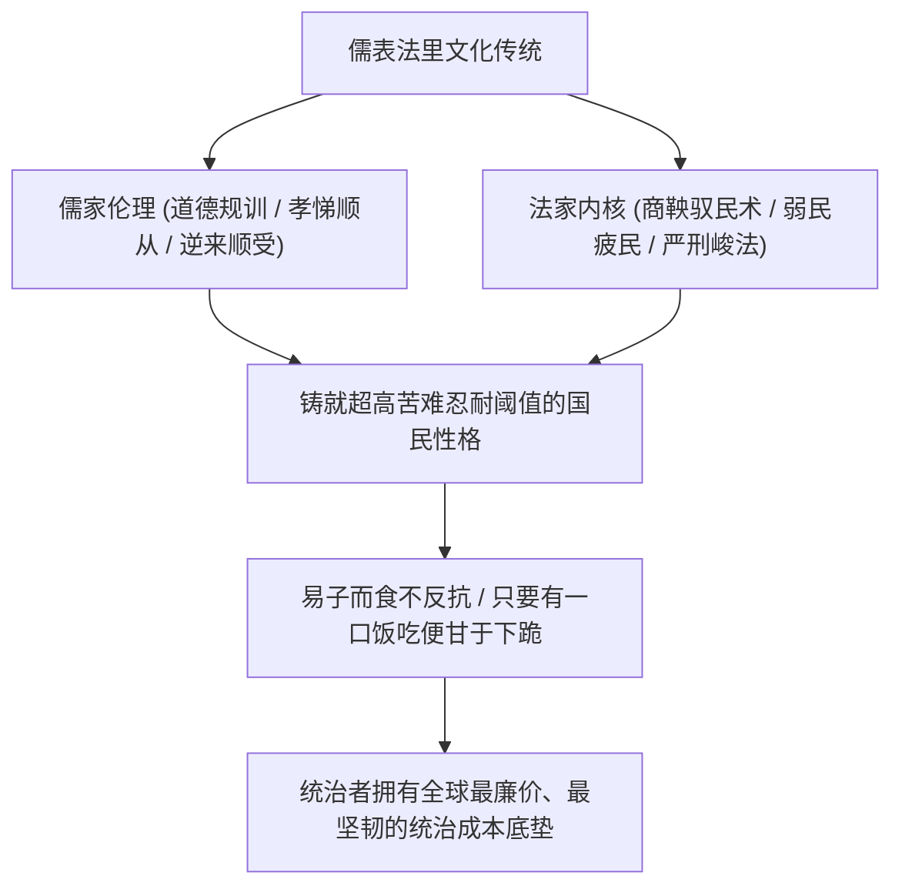

百年以来，知识界常有学者发问：“封建王朝终结之后，为什么专制统治的思维惯性依然长存？”

答案并不复杂：**很多人思想深处的依附惯性与等级思维依然深厚，文化基因的代际传递具有强大的历史黏性。**

传统社会形成的顺从性心理、对公权力的习惯性畏惧、以及面对生存波动的超强耐受力，提供了独特的社会治理土壤。当两千年“儒表法里”的制度经验，结合数亿监控节点、人脸识别算法与大数据出行风控等现代数字化工具时，国家机器的管控效率并未被所谓的维持成本拖垮，反而形成了低边际成本、强覆盖力的高效运转网络。

---

### 一、 儒表法里的文化基因：极高耐受阈值的顺民底盘

商鞅在两千多年前就将法家驭民的核心秘诀总结为**弱民、疲民、贫民、辱民**。这套冷酷的控制逻辑，在历朝历代披上了一层儒家“君臣父子、忠孝仁义”的道德伦理外衣，在客观上将庞大人口塑造为相互制约且承受力极强的基层群体：



1. **耐受力极强的社会心理底盘**：
   - 面对历史上的经济困难与政策动荡，基层群体往往表现出极强的生存适应性与忍耐韧性，普遍秉持实用主义的生存智慧；
   - 只要能够维系基本口粮，社会自发的抗争烈度就极低，使得体制在面对宏观经济下行周期时，不需要像西方高福利社会那样承担庞大的选民再分配支出；
2. **制度转嫁的顺畅通道**：
   - 在传统的治理认知中，基层群体长期扮演着吸收改革成本与宏观波动的蓄水池角色；
   - 面对财政收支缺口，行政力量向基层推进税费收缴或压缩福利支出时，遭遇的社会阻力远低于西方民主代议制社会。

---

### 二、 数字天网与现代科技：法家统治术的技术升级

部分观点认为“全域数字化监控的电费与服务器折旧将拖垮地方财政”。这种论断低估了现代规模化安防工业的技术压制效率：

```text
+-------------------------------------------------------------------------+
|                  传统清朝控制 vs 现代数字天网控制对比                   |
+-------------------+-----------------------------------------------------+
| 比较维度          | 清朝衙役与保甲制              | 现代"AI + 天网 + 购票风控"          |
+-------------------+-------------------------------+---------------------+
| 响应时效          | 依靠快马传书，以天/周为单位   | 毫秒级抓取比对，秒级联动锁定        |
+-------------------+-------------------------------+---------------------+
| 物理活动范围      | 靠关卡路引，仍有山林死角逃亡  | 高铁/飞机/长途车全闭环，重点人插翅难飞|
+-------------------+-------------------------------+---------------------+
| 基层动员成本      | 地方宗族有阻力，容易官逼民反  | 算法自动封禁，基层机器化执行，无情冷酷|
+-------------------+-------------------------------+---------------------+
| 反抗苗头遏制      | 形成集会聚众后才派兵镇压      | 微信群聊/买票环节秒级扼杀在萌芽状态 |
+-------------------+-------------------------------+---------------------+
```

- **精准切断空间流动性**：
  - 数亿个监控探头日夜巡视，人脸识别系统在极短时间内完成特征比对；
  - 重点上访人员或特定管控对象的证件信息一旦接入交通系统，闸机可在秒级触发告警与通道拦截，有效控制跨区流动；
  - 许多潜在的群体性诉求在萌芽期便被大数据风控与户籍联动系统化解在属地范围内；
- **边际运行成本低廉**：
  - 安防模型与算法开发属于一次性研发投入，规模化部署至全国后，边际单次识别成本极低；
  - 结合辅助警力与基层社区网格队伍的严密排班，技术与人力的结合使得治安管理在基层形成了强效的执行网络。

---

### 三、 破除创新迷思：后发优势与应用型技术快速平替

外界常以“严密管制必然压抑创新活力”为由质疑其产业前景，但从现实产业竞争来看，后发国家具备独特的演进路径：


1. **后发追赶的实用主义**：
   - 在已有成熟技术路径的领域，通过技术引进、工艺模仿、供应链整合与规模化降本，往往是速度最快、风险最小的工业追赶策略；
   - 从高铁、面板到光伏、新能源汽车，中国依托全产业链配套与庞大的工程师队伍，迅速将高端技术转化为极具性价比的大规模工业品；
2. **决策层的信息统筹与实用考量**：
   - 官僚体系核心层长期深耕基层治理，对基层的隐性诉求与上报水分有着清晰的经验判断；
   - 容许局部的缓冲与信息折损，本身就是维系庞大行政系统运转弹性的务实策略。

正如翟东升在《中国为什么有前途》（机械工业出版社，2019年）中所分析的，庞大的内需纵深、完整的工业制造门类与每年数百万理工科人才，赋予了中国在应用型工业技术平替上的独特韧性。西方仅凭特定前沿单品的封锁，难以动摇成熟工业门类的整体协同生产力。

---

### 四、 核心总结

分析特定社会的制度稳定性，需要看清文化传统与现代技术的双重加持：

**深厚的依附型文化土壤，与现代数字化管控网络形成了紧密的契合。**

历史积淀的臣民服从惯性，在现代科技赋能下转化为了极高的行政控制力与相对低廉的维持成本。这种文化基因与治理手段的融合，构成了大一统体制在当代长期维持稳定的现实基础。

---

### 参考文献与延伸阅读

1. 温铁军. 新中国十次周期性经济危机[M]. 北京: 东方出版社, 2013.
2. 翟东升. 中国为什么有前途[M]. 3版. 北京: 机械工业出版社, 2019.
3. 翟东升. 货币、权力与人: 全球货币与金融体系的民本主义政治经济学[M]. 北京: 中国社会科学出版社, 2019.