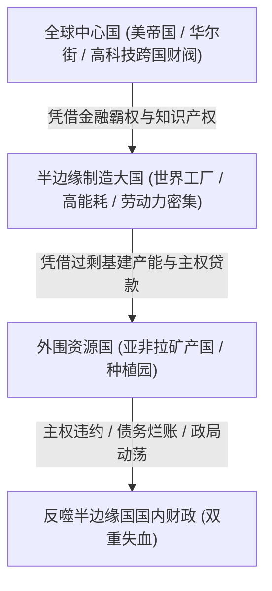
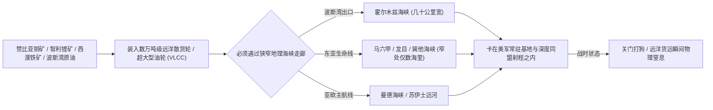
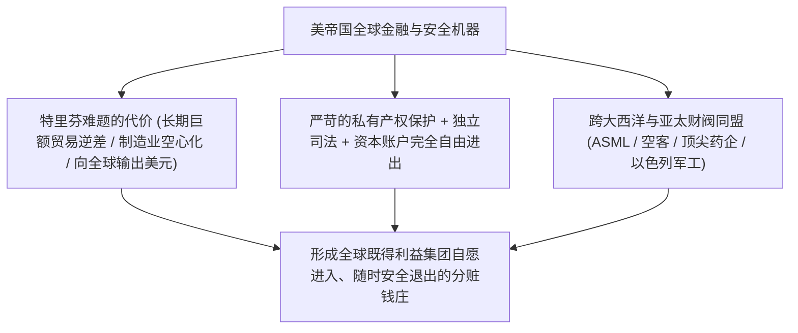

在探讨当今国际博弈与地缘冲突时，社会达尔文主义视角经常流行一种极具蛊惑力的判断：“国际社会本质上是弱肉强食的无政府丛林，规则不过是强者制定的遮羞布。只要拳头够硬、有枪有炮，没有什么正版与盗版帝国，只有在牌桌上还是在菜单上的差别。”

然而，把“潜在的军事毁灭力”等同于“可持续的全球霸权支配力”，严重低估了现代帝国体系赖以运转的**高阶金融物理结构与地缘海权硬约束**。

结合温铁军在《全球化与国家竞争》中对“全球资本主义中心国、半边缘国与外围国三层依附与成本转嫁体系”的深刻解构，便能看清：**现代真正的全球霸权，从来不是单靠军舰抢劫，而是建立在一套极其精密的全球开放分赃与金融泄洪网络之上**。

当半边缘制造大国误以为“只要枪杆子硬、靠印钞和主权贷款就能征服亚非拉”时，往往是在押上整副身家之后，陷入更深层的外部失血泥潭。

---

### 一、 温铁军视角：世界体系的三层转嫁金字塔

温铁军指出，现代全球化竞争的实质，是资本主义世界体系的**“级联式制度成本转嫁”**：



```text
+-------------------------------------------------------------------------+
|                  全球资本主义三层金字塔与功能异化对比                   |
+-------------------+-----------------------------------------------------+
| 体系层级          | 核心功能                      | 危机转嫁路径        |
+-------------------+-------------------------------+---------------------+
| 中心国 (美欧)     | 垄断全球金融清算、规则、高端科技| 承担逆差输出货币，将制造业空心化与通胀|
|                   | 掌握全球终端有效购买力        | 甩给半边缘国承担                    |
+-------------------+-------------------------------+---------------------+
| 半边缘国 (中国)   | 世界工厂，承担实体生产与资源消耗| 依靠巨额顺差赚外汇，试图向外围输出产能|
|                   | 创造全球最大的工业剩余价值    | 却无法建立全球硬通货清算闭环        |
+-------------------+-------------------------------+---------------------+
| 外围国 (亚非拉)   | 廉价原材料与能源供应地        | 极度贫困，无有效支付能力，频繁违约  |
+-------------------+-------------------------------+---------------------+
```

半边缘制造大国在体系中的致命宿命在于：**它既承受着中心国高科技封锁与金融周期抽血的压力，又在向外围国（亚非拉）输出过剩产能时，背负上沉重的主权债务坏账**。

---

### 二、 “只要资源不要钱”的致命前提：远洋海权与地理咽喉

有人设想：“我们不需要欧美的货币，直接用基建和债务置换亚非拉的矿山、油田与港口，控制全球实物资源。”

这种逻辑在现代地理与海权现实面前，首先撞上了一堵无法逾越的高墙：**全球远洋航线与狭窄海峡咽喉**。



1. **“近海拒止”不等于“全球远洋护航”**：
   - 必须承认，在第一岛链内，依托陆基高超音速导弹、岸基航空兵与饱和打击体系，区域拒止（A2/AD）能够确立极强的局部威慑；
   - 但远洋公海护航是两套完全脱节的军备与地缘逻辑。美军控制公海，从来不是巡逻七大洋的每一寸海水，而是依托横须贺、关岛、迪戈加西亚、巴林、苏达湾等全球数百个常驻军事基地，**扼守全球八大关键海运咽喉**；
2. **缺乏全球基地网的舰队是强弩之末**：
   - 远离本土几千海里后，远洋商船没有沿途各国的油料补充、淡水补给与防空庇护。一旦爆发系统性封锁，对手甚至不需要深入矿山抢夺，只需在海峡口设卡截流，海外矿井开采出的矿石就只能烂在当地港口；
3. **现代经济战的“节点武器化与通道剥夺”**：
   - 正如翟东升、嵇先白与魏子龙在《制裁与经济战：国力碰撞的大争之世，中国如何把握主动》（中国人民大学出版社，2025年）中所论证：现代经济战的最高形态已非传统平面封锁，而是**“关键战略节点武器化（Weaponized Interdependence）”**。拥有全球基地与远洋海权的主导国，只需依托关键海峡节点与金融清算通道发起二级制裁与长臂管辖，即可达成“物理断航”与“金融断血”的复合绞杀，让缺乏远洋护航与国际法话语权的工业实体陷入孤岛状态。

---

### 三、 买方市场的“有效支付能力悖论”

关于“抛开西方黄金十亿人，拉拢亚非拉三十亿人，就能再维持数百年工业扩张”的宏大叙事，忽视了国际经贸中最基础的规律：**市场依靠的是有效支付能力（净购买力），而不是人口头颅的算术堆叠**。

在翟东升与朱煜合著的《缠斗：中美经贸重构与全球经济新秩序》（中信出版集团，2026年）中，系统提出了当今大国博弈的核心结构：**“全球终极买方市场（美）与超级供给产能（中）的不对称博弈”**。在全球经贸深度互嵌与新秩序演进中，中国依托完备的供应链与规模效应构成了超级供给者，而美国则凭借高人均消费支出、深厚金融吸纳池和美元特权牢固占据着全球最终需求的买方地位。这种结构性错配决定了双方陷入深度的长期“缠斗”，单方面试图通过转向欠发达市场来摆脱对终极买方依赖的设想，在现实经济学中必然撞上支付能力的硬约束：

```text
+-------------------------------------------------------------------------+
|                  欧美终端消费市场 vs 亚非拉大宗市场对比                 |
+-------------------+-----------------------------------------------------+
| 比较维度          | 西方"黄金10亿人"市场          | 亚非拉"30亿人"市场  |
+-------------------+-------------------------------+---------------------+
| 全球消费占比      | 占全球超 60% 终端高附加值需求 | 绝大多数人均 GDP 在 1000-3000 美元  |
+-------------------+-------------------------------+---------------------+
| 利润反哺能力      | 提供高额毛利，反哺高薪研发体系| 只能消化廉价白牌，压榨全链条代工利润|
+-------------------+-------------------------------+---------------------+
| 结算资金来源      | 真实硬通货顺差 (美元/欧元净流入)| 严重依赖中方主权贷款注水 (左手倒右手)|
+-------------------+-------------------------------+---------------------+
| 坏账违约风险      | 极低，受成熟市场契约与法治保护| 极高，外汇见底频繁主权违约 (斯里兰卡)|
+-------------------+-------------------------------+---------------------+
```

1. **谁来为高端产业研发买单？**
   - 支撑数十万高薪工程师、尖端医药研发与芯片迭代的高毛利，绝大多数来自欧美日韩等高收入市场；
   - 亚非拉国家需要的是极致廉价的农机、轻工与白牌消费品，根本无法承载高端产业链升级所需的溢价空间；
2. **“用自己的贷款买自己的货”的坏账死结**：
   - 过去十余年面向第三世界的经贸输出，大量演变为“中方提供主权外币贷款 -> 当地采购中方钢筋水泥基建 -> 当地外汇枯竭主权违约”的怪圈；
   - 最终形成的巨额坏账只能由国内财政兜底展期。正如温铁军所解剖的，这不是在从外部吸血，而是**拿国内普通打工人的剩余价值与储蓄，去单向补贴外部的烂泥潭**。

---

### 四、 美帝国的“正版机制”：全球分赃与私有产权承诺

很多人误以为美国的本质就是“靠美军拿枪抢劫”，只要军备够硬，就能照搬这套玩法。

但美帝国之所以能维持近百年的金融吸血网络，其底层是由**极其精密、且半边缘国家在客观体制上完全互斥**的共生机器构成的：



1. **特里芬难题的制度代价**：
   - 美元要成为全球储备货币，前提是美国必须**长期维持巨大的外贸逆差**（买全球商品，把美元撒向全球），其惨痛代价是美国本土中低端制造业彻底空心化；
   - 一个靠巨额贸易顺差维持经济循环的制造大国，在客观机制上根本无法将本币像自来水一样注满全球的流动性池子；
2. **美债美股能吸血的根本前提：资本可以随时安全变现跑路**：
   - 为什么沙特王室、欧洲主权基金甚至全球权贵愿意将命根子资产配置在美债美股？因为美国有**严苛的私有产权保护、独立的司法系统、以及完全自由进出的资本账户**；
   - 全球资本清楚：哪怕今天跟白宫翻脸，明天去联邦法庭打官司，自己的私有财产也不会被一张行政红头文件直接清零；
   - 顺差国如果维持严格的外汇管制、股市动辄限制卖出、行政命令可一夜消灭一个万亿产业，外部资本只会将其视为“特许提货凭证”，绝不可能把生死资产交由不可预测的黑箱托管。

在魏伦、翟东升等编著的《大国货币》（北京大学出版社，2015年）中对近代霸权货币（英镑、美元）历史兴衰的解构表明：**全球主权货币的霸权地位，从不是由顺差规模决定的，而是由“规则制定权、离岸清算网络、以及向全球提供最终清偿资产的能力”共同锁定的**。美元体系通过输出逆差、提供深不可测的国债资产池，构建了全球利益集团的“安全避风港”。试图在维持高度资本管制和行政干预的同时打造全球储备货币，在货币金融史上从来没有成功的先例。

---

### 五、 美以同盟的解构：“尾巴摇狗”的地缘异化

在国际政治与战略分析中，美以关系经常被戏称为经典的“尾巴摇狗（The tail wagging the dog）”——到底是美国控制以色列，还是以色列绑架美国？

美以关系绝不是单纯的“主仆”结构，而是一种极其罕见的、相互深度绑架的**“共生帝国怪胎”**：

```text
+-------------------------------------------------------------------------+
|                        美以同盟的双向绑定与异化机制                     |
+-------------------+-----------------------------------------------------+
| 观察维度          | 微观战术操作 (小国绑架大国)   | 宏观底层生存 (大国决定生死)         |
+-------------------+-----------------------------------------------------+
| 驱动核心          | AIPAC游说金主与超级PAC精准狙击| 美军C-17空中走廊弹药与航油输血      |
|                   | 基督教福音派数千万选票绑架    | 联合国安理会一票否决权充当防弹衣    |
+-------------------+-----------------------------------------------------+
| 行为模式          | "先动手、后通知"既成事实绑架  | 中东"永不沉没的航母"，充当顶级驻屯军|
+-------------------+-----------------------------------------------------+
| 系统代价          | 牵着白宫鼻子走，透支美国国际信誉| 失去美国，以色列瞬间沦为孤立的贱民国家|
+-------------------+-----------------------------------------------------+
```

- **微观层面的寄生与倒挂**：以色列政客通过美国国内的游说资金（AIPAC）、白人基督教福音派的宗教选票（共和党核心铁票仓），以及肆无忌惮的军事冒险，经常能公然羞辱白宫、迫使美军航母前去护航；
- **宏观层面的绝对依附**：现代高强度防空战打的是工业产能。铁穹拦截弹、航弹与 F-35 零部件全靠美军空中运输走廊维持。如果切断军援与安理会否决权，以色列在数月内就会面临物理上的弹药枯竭与国际制裁孤立；
- 这是一个大国为了地缘控制养了一头凶悍斗犬，斗犬利用大国内部的政治脓疮反向寄生，双方明知互有算计却谁也离不开谁的怪胎同盟。

---

### 六、 结语：盗版玩不成正版的帝国

国际社会确实处于现实主义的无政府丛林，但绝对的硬实力拥有极其昂贵的**维护折旧率**与**边际效益递减规律**。

结合温铁军对全球化与国家竞争的深刻洞见：美国霸权的真正可怕之处，不在于其航母敢满世界开火，而在于它一手拿着全球最强的科技与军工暴力，另一手搭出了**一个向全球开放、产权明确、让全球既得利益集团自愿分赃的金融寄生网络**。

如果半边缘制造大国误以为“只要学到了它的霸道、学到了它的军队、学到了它的印钞，就能复制这套吸血大业”，最终的下场往往是：

**没有它向全球泄洪的金融开放度与司法信用，却背上了比它更沉重的海外维稳与单向输血包袱；没有它源源不断的高科技原创暴利，却搞了一堆只能靠国内老百姓勒紧裤腰带去擦屁股的海外坏账烂摊子。**

这绝非登上了霸权牌桌，而是踩着历史上所有帝国衰落的大坑，在通往不可逆透支的道路上加速狂奔。

---

### 参考文献与延伸阅读

1. 温铁军. 全球化与国家竞争: 新兴七国比较研究[M]. 北京: 人民出版社, 2021.
2. 翟东升, 朱煜. 缠斗: 中美经贸重构与全球经济新秩序[M]. 北京: 中信出版集团, 2026.
3. 翟东升, 嵇先白, 魏子龙. 制裁与经济战: 国力碰撞的大争之世, 中国如何把握主动[M]. 北京: 中国人民大学出版社, 2025.
4. 魏伦, 翟东升, 等. 大国货币[M]. 北京: 北京大学出版社, 2015.
