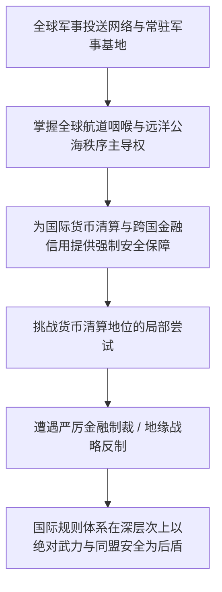

国际政治分析中，舆论往往倾向于援引“基于规则的国际秩序”、“自由贸易协定”与“多边国际法”等法理框架。

然而，从进攻性现实主义视角切入，国际关系的现实底色始终离不开实力的背书：

**国际体系在深层次上依然呈现出无政府状态（Anarchy）的特征，综合国力与战略威慑力是界定规则边界的硬指标。**

二战以来的多次地缘冲突表明，大国在涉及自身核心安全与战略资源利益时，多次绕开多边机构采取单边军事与金融行动。所谓的国际惯例与规则，往往是大国博弈达成妥协后的阶段性产物。

在国际舞台的利益分配中，**核心在于一国是具备制定规则、参与分配的主动权，还是只能作为外部力量调配的被动承受者**。

---

### 一、 霸权体系的物质支撑：军事威慑与金融计价

很多人将主权国家的金融影响力单纯归结为资本市场技术和离岸清算网络，这忽视了其背后的战略安全支撑：



1. **安全保障与货币信用的深度共生**：
   - 国际主权货币的流通，不仅依赖成熟的资本市场，更离不开保护国际贸易航道与金融资产安全的强制力量；
   - 面对外部主权违约或战略挑战，金融冻结、大宗商品禁运与长臂管辖等经济战手段能够生效，前提是拥有全球性的执法与威慑能力；
2. **美以同盟的地缘协同逻辑**：
   - 美以关系被广泛讨论，其本质展现了区域前沿盟友与全球霸权之间的深度利益绑定；
   - 作为中东地区具备极强战术动员与情报能力的重要支点，以色列在特定行动中往往展现出高度自主性，甚至反向影响华盛顿的中东政策；
   - 这种关系体现了大国战略网络中的复合共生机制：核心大国提供武器弹药与外交背书，区域前沿支点承担地缘威慑与战略平衡职责。

---

### 二、 市场格局重塑：全球南方市场的战略纵深

西方传统消费市场虽然成熟，但随着人口结构老龄化与再工业化政策推进，贸易保护与技术壁垒日益提升。放眼全球，以“全球南方”为主的新兴经济体展现出广阔的需求空间：

```text
+-------------------------------------------------------------------------+
|                  西方成熟市场 vs 全球南方新兴市场对比                   |
+-------------------+-----------------------------------------------------+
| 观察维度          | 西方成熟消费市场              | 全球南方新兴经济体                  |
+-------------------+-------------------------------+---------------------+
| 人口结构          | 老龄化加剧，边际消费饱和      | 年轻人口占优，城镇化与基建需求迫切  |
+-------------------+-------------------------------+---------------------+
| 经贸合作特点      | 伴随高标准准入、合规审查与地缘限制| 聚焦基础设施、实体工业品与产能合作  |
+-------------------+-------------------------------+---------------------+
| 战略互补性        | 传统高附加值买方市场          | 提供原油、锂、铜等战略矿产与市场纵深|
+-------------------+-------------------------------+---------------------+
| 秩序走向          | 维护既有跨大西洋经贸规则      | 推动本币结算与双边本币互换多边化    |
+-------------------+-------------------------------+---------------------+
```

- **实体工业与战略资源的置换闭环**：
  - 全球南方国家拥有丰富的基础原料与矿产禀赋，但面临基础设施欠账与工业品匮乏的双重挑战；
  - 中国凭借完备的基建工程实施能力与高性价比的成套工业装备，能够与拉美、非洲、东南亚的矿产、港口与农业资源形成深度互补，构建非西方主导的南南合作闭环；
- **三十亿人口体量的工业化红利**：
  - 通过“一带一路”互联互通、电信基础设施与数字支付合作，中国产业链标准在新兴市场逐步扎根；
  - 这种经贸纽带不仅缓解了国内成熟工业门类的过剩产能，更为长期获取关键工业资源提供了多元化的安全保障。

---

### 三、 经贸出海与安全护航的协同演进

大国经贸在全球范围内的拓展，必然推动外部治理与安全战略的配套演化：


1. **人民币国际化的实物锚定**：
   - 正如翟东升与朱煜在《缠斗：中美经贸重构与全球经济新秩序》（中信出版集团，2026年）中所阐述：中美经济关系已进入复杂的长周期博弈；
   - 中国作为超级制造基地，正逐步将跨境清算与实物提货能力挂钩；
   - 国际买方持有人民币能够直接采购种类齐全的现代化工业品，这种强大的实物兑付能力，构成了抵抗外部金融断流的核心屏障；
2. **海外利益保护的客观要求**：
   - 随着海外港口、矿产资产与海外企业员工体量激增，提升远洋投送与联合安保能力成为客观必然；
   - 依靠商业互利为主导，辅以合规高效的海外利益安全保护机制，是跨国经贸可持续发展的基础。

---

### 四、 核心总结

国际秩序的演变始终由物质生产力与综合实力所驱动：

**规则往往由具备坚实实体产业与战略定力的国家所共同塑造。**

面对复杂的外部大争之世，摒弃非黑即白的道义叙事，依靠全球规模第一的实体制造产能、持续提升的技术创新能力与稳健的多边经贸网络，后发大国正在逐步确立更加从容的地缘博弈主动权。

---

### 参考文献与延伸阅读

1. 翟东升, 朱煜. 缠斗: 中美经贸重构与全球经济新秩序[M]. 北京: 中信出版集团, 2026.
2. 翟东升, 嵇先白, 魏子龙. 制裁与经济战: 国力碰撞的大争之世, 中国如何把握主动[M]. 北京: 中国人民大学出版社, 2025.
3. 魏伦, 翟东升, 等. 大国货币[M]. 北京: 北京大学出版社, 2015.
4. 温铁军. 全球化与国家竞争: 新兴七国比较研究[M]. 北京: 人民出版社, 2021.