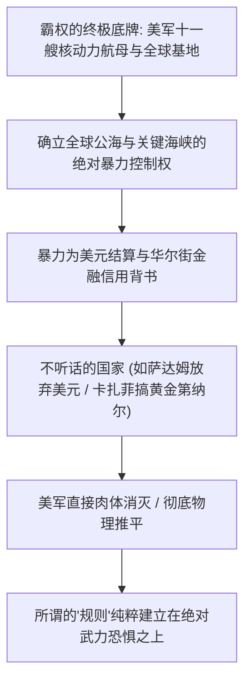

国际政治的学者们往往喜欢用“基于规则的国际秩序”、“自由贸易”和“国际法体系”等华丽词藻给全球竞争涂脂抹粉。

然而，撕开温情脉脉的道德伪装，国际关系的冷酷真相只有一条：

**国际体系本质上是彻底的无政府状态（Anarchy），弱肉强食，谁胳膊粗谁说了算！**

美国、北约、以色列在过去几十年里一直是这么玩的：未经联合国授权轰炸南联盟、以莫须有罪名入侵伊拉克、在拉美精准策动政变强占油田、定点清除主权国家高级将领。所谓的国际规则，不过是强权在餐桌上用来切肉的刀叉。

在这个残酷的丛林里，**根本没有什么“正版帝国”与“盗版帝国”的高下之分，只有“坐在牌桌上吃肉”还是“被印在菜单上当菜”的生死差别**。

---

### 一、 霸权的真正底牌：军队才是终极信用锚

很多人误以为美国的本质是靠“华尔街的金融技术”和“美元美债循环”在维系，这完全是倒果为因：



1. **没有武力护航的金融只是一张废纸**：
   - 萨达姆试图用欧元结算石油，卡扎菲试图建立全非黄金第纳尔体系，他们的下场无一不是被美军从地洞里抓出来绞死、或者在乱枪中横死街头；
   - 委内瑞拉敢不听话，美国就公然扣押其海外油轮、冻结其黄金储备、甚至跨国绑架其总统密使。美帝国的底牌从来不是什么温良恭俭让的司法程序，而是十一艘核动力航母与遮天蔽日的战略轰炸机编队；
2. **美以同盟的“凶悍互绑”模式**：
   - 美以关系被戏称为“尾巴摇狗”，到底谁是尾巴谁是狗？这恰恰是丛林法则最生动的写照：
   - 以色列作为中东战斗力最凶悍的顶级驻屯军，肆无忌惮地实施定点清除、突袭邻国，逼着华盛顿在联合国安理会动用一票否决权，甚至调遣航母战斗群前去贴身护航；
   - 双方明知互有算计，却在跨大西洋的资本、情报与军工网络中焊死在一起。角色随时互换，谁凶狠谁主导战术，这正是帝国与前沿斗犬之间纯粹力量与利益绑定的典范。

---

### 二、 G2格局确立：破除西方“黄金十亿人”的迷思

西方学者常拿“欧美高消费市场无法替代”来恐吓后发大国。然而，放眼全球 80 亿人口，西方所谓的“黄金 10 亿人”正在不可逆地老龄化与相对衰落：

```text
+-------------------------------------------------------------------------+
|                  西方黄金10亿人市场 vs 全球南方30亿人市场对比           |
+-------------------+-----------------------------------------------------+
| 观察维度          | 西方"黄金10亿人"市场          | "一带一路"与全球南方30亿人口市场    |
+-------------------+-------------------------------+---------------------+
| 人口态势          | 严重老龄化，消费总量见顶，高壁垒| 年轻人口充沛，工业化与基建需求极度饥渴|
+-------------------+-------------------------------+---------------------+
| 经贸本质          | 附带严苛地缘政治制裁与长臂管辖| 只要搞定基建与工业品，以真实资源置换|
+-------------------+-------------------------------+---------------------+
| 战略目标          | 试图脱钩断链，将中国锁死在低端| 提供广袤资源腹地 (锂/铜/原油/农田)  |
+-------------------+-------------------------------+---------------------+
| 游戏规则          | 按照西方霸权指定的菜单吃肉    | 重塑平行双轨体系，中国直接上桌坐庄  |
+-------------------+-------------------------------+---------------------+
```

- **我们要的是土地、矿山与资源，不是纸币！**
  - 西方还在算计货币利润，中国在全球南方的战略锚点极其现实：智利的锂矿、赞比亚的铜矿、波斯湾的石油、几内亚的铝土矿、非洲的优良深水港口与广袤耕地；
  - 我们根本不需要亚非拉那点微薄的本国纸币，而是用中国无可匹敌的基建施工能力、成套工业装备与全产业链产能，去置换控制现代工业赖以运转的**实体硬资源**；
- **影响 30 亿人，足以为大国再续几百年国运**：
  - 中国不需要像传统殖民者那样派驻总督，中国只需要通过“一带一路”基础设施、5G 通信网络、数字支付系统与庞大实物贸易，给全球南方 30 亿人也套上深度的利益羁縻与技术标准；
  - 只要他们需要物美价廉的中国汽车、手机、化肥、高铁与光伏，只要他们的资源源源不断向东方输送，这一片庞大的南南大陆就足以打破任何西方阵营的封锁。

---

### 三、 规则由强者书写：能用货币控制就用货币，实在不行军队也是底牌

中国在国际舞台上的崛起，秉持的是极度成熟的现实主义智慧：


1. **人民币出海是实物兑换力的自然外溢**：
   - 正如翟东升与朱煜在《缠斗：中美经贸重构与全球经济新秩序》（中信出版集团，2026年）中所剖析的：中美博弈已经进入不可逆的“深层缠斗”阶段；
   - 中国作为拥有全球最强实物供给能力的超级生产者，面对美西方的制裁与长臂管辖，正在加速构建一套平行的跨境支付清算与大宗商品结算网络；
   - 外国人拿着人民币能在中国买到全世界最完备的实物工业品，这种不可替代的供给能力，正在逐步剥夺西方金融战工具的威慑力；
2. **“世界警察”的客观历史必然**：
   - 当中国的海外资产、港口、矿山与工程人员遍布全球时，保护海外利益就成了必然的诉求；
   - 亚非拉部落如果政变毁约、反华势力如果胆敢武装破坏，这正好为中国军事力量合情合理走向远洋、充当海外秩序的坚定维护者提供了法理与现实依据；
   - 能用人民币和商业解决，就用商业合作；如果对方敬酒不吃吃罚酒，人民军队的航母战斗群与远洋陆战队，同样是随时可以掀开的钢铁底牌！

---

### 四、 结语

世界从未太平，人类文明从未走出达尔文丛林：

**弱者哀鸣规则被践踏，强者手握重兵重塑秩序。**

在这个弱肉强食的大争之世，没有什么所谓的正版与盗版。手握全世界最庞大的实体工业产能、十四亿高组织度的国民、以及日益强大的深海与远洋武装，中国已经稳稳坐上了决定人类未来的主牌桌。谁试图把中国塞进菜单，谁就必须准备好承受帝国崩裂的粉碎性打击！

---

### 参考文献与延伸阅读

1. 翟东升, 朱煜. 缠斗: 中美经贸重构与全球经济新秩序[M]. 北京: 中信出版集团, 2026.
2. 翟东升, 嵇先白, 魏子龙. 制裁与经济战: 国力碰撞的大争之世, 中国如何把握主动[M]. 北京: 中国人民大学出版社, 2025.
3. 魏伦, 翟东升, 等. 大国货币[M]. 北京: 北京大学出版社, 2015.
4. 温铁军. 全球化与国家竞争: 新兴七国比较研究[M]. 北京: 人民出版社, 2021.