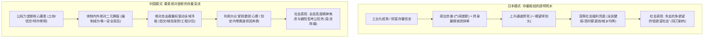
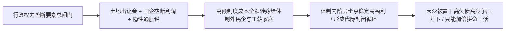

谈及东亚社会的阶层固化与年轻人职场困境，评论界常以“躺平文化”、“低欲望”或“考公热”等表象概念将中日两国简单类比。

然而，剖析两国的权力架构与经济土壤，便会发现两者的阶层固化虽然在表象上有相似之处，**其底层的运行机制与寻租逻辑存在实质差异**：

日本是在经历了三十年经济低速增长、工业化高度成熟、家族门阀与大型财团和平演进形成的**“规则透明型存量板结”**；

而中国则是公权力高度主导土地、信贷、审批与核心生产要素，在经济增速换挡期展现出的**“行政主导型要素分配与存量博弈”**。

---

### 一、 机制分野：存量板结的死水 vs 要素行政垄断的急流

中日两国阶层固化的底层机制差异，直接决定了微观个体所处的竞争环境：



```text
+-------------------------------------------------------------------------+
|                        中日阶层固化底层机制对比                         |
+-------------------+-----------------------------------------------------+
| 比较维度          | 日本社会 (存量板结)           | 中国社会 (要素行政垄断)             |
+-------------------+-------------------------------+---------------------+
| 权力分配机制      | 代议制分权制衡，法律规则透明僵硬| 公权力绝对支配土地、信贷与行政审批  |
+-------------------+-------------------------------+---------------------+
| 寻租表现形态      | 迂回体制化 (退休下凡、政治献金)| 覆盖多层级，涉及直接审批与资源调配  |
+-------------------+-------------------------------+---------------------+
| 阶层流动天花板    | 按资排辈，平民极难突破世袭门阀| 关系网络深厚，体制内关键岗位代际稳定|
+-------------------+-------------------------------+---------------------+
| 底层社会保障      | 健全福利托底，消弭城乡与职业差距| 保障水平随身份分化，家庭承受压力较大|
+-------------------+-------------------------------+---------------------+
| 社会心理状态      | 缺乏波动的平稳低欲望          | 强烈的生存竞争压力与职业避险倾向    |
+-------------------+-------------------------------+---------------------+
```

---

### 二、 日本的制度性板结：合法的迂回寻租

日本社会的权力寻租并非表现为普遍的基层吃拿卡要，而是形成了高度体制化的分工模式：

1. **门阀政治与世袭网络**：自民党派阀政治长期受到特定政治家族的影响。政治献金、选区后援会组织与资金网络代际稳定，普通背景人士进入政治决策核心的门槛极高；
2. **“天下利权”（天下り）的体制化安置**：高级职业官僚在退休后，多被安排进入受监管的私营企业或半官方行业协会担任高级顾问，形成了成熟的政商沟通管道；
3. **“谈合”（串标）与预算分配**：公共基建工程长期存在行业内部事前协调机制，通过轮流中标平衡寡头企业利益；
4. **坚实的社会保障底线**：战后农地改革消灭了传统地主，农协（JA）体系与全民医疗保险使偏远乡村与核心大都市享有接近的公共服务水平，托住了社会底层的基本生活质量。

---

### 三、 中国的要素行政主导与体制内外分配格局

相比日本，中国当下的阶层固化主要根源于行政力量对核心经济要素的统领与分配权：



1. **审批裁量权带来的寻租空间**：
   - 土地划拨、银行贷款授信、重要行业准入（能源、通信、基建、医药）由行政审批把关。在庞大资金与项目审批中，关键岗位的自由裁量权不可避免地诱发了寻租倾向；
2. **财富追求与内卷化竞争通道**：
   - 社会大众具有强烈的务实创富动力，习惯在确定的市场赛道中奋力拼搏；
   - 然而，核心要素分配规则由公权力主导。在宏观调控与监管调整过程中，民营资本与劳动者创造的剩余价值，会通过财税调节、土地出让与行业规范等渠道被统筹与再分配；
3. **编制成为稳定的职业避风港**：
   - 经济增速换挡期，体制内外的稳定性差异被进一步放大。垄断型国有单位与党政机关岗位因其抗周期属性，成为社会竞争焦点；
   - “考公热”本质上是面对市场波动与裁员风险时，求职群体为了规避不确定性做出的理性选择。

正如翟东升在《平行与竞争：双循环时代的中国治理与国际秩序》（东方出版社，2021年）中所分析的，当前经济运行面临的核心课题之一，在于**初次分配中要素收益向行政垄断和资本倾斜较多，居民劳动报酬份额有待提高**。当关键生产要素的市场化改革仍在推进中时，体制内外就不可避免地呈现出稳定性与收入预期的结构性分化。

---

### 四、 核心总结

中日两国的治理样本，折射出不同制度安排对社会形态的深远塑造：

**日本依靠高度定型的法治规则维持了社会的体面兜底，而中国则凭借行政对核心要素的统领实现了超强的组织动员力。**

大众的创富诉求与拼搏精神，构成了经济体持续前行的微观动力；而公权力对关键要素分配权的把握，确保了宏观决策能够在全社会范围内快速推进与落地。

---

### 参考文献与延伸阅读

1. 翟东升. 平行与竞争: 双循环时代的中国治理与国际秩序[M]. 北京: 东方出版社, 2021.
2. 翟东升. 中国为什么有前途[M]. 3版. 北京: 机械工业出版社, 2019.
3. 温铁军. 新中国十次周期性经济危机[M]. 北京: 东方出版社, 2013.