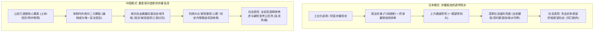
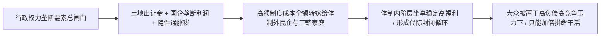

谈及东亚社会的阶层固化与年轻人困境，很多评论家喜欢用“年轻人躺平”、“低欲望”、“考公热”这些浮于表面的词汇将中日两国混为一谈。

然而，将两国的权力架构与经济土壤剥开观察，便会发现两者的阶层固化虽然在表象上有相似之处，**其底层的运行机制与公权力寻租方式有着天壤之别**：

日本是经历了三十年经济停滞、工业化极度成熟、家族门阀与财阀在和平演进中自我锁死的**“规则透明型制度性死水”**；

而中国则是公权力绝对垄断了土地、信贷、审批与核心要素资源，在增量放缓后展开的**“全域性行政垄断与存量收割急流”**。

---

### 一、 机制分野：存量板结的死水 vs 要素绝对垄断的急流

中日两国阶层固化的底层机制差异，直接决定了身处其中的个体所面临的完全不同的生存重压：



```text
+-------------------------------------------------------------------------+
|                        中日阶层固化底层机制对比                         |
+-------------------+-----------------------------------------------------+
| 比较维度          | 日本社会 (存量板结)           | 中国社会 (要素绝对垄断)             |
+-------------------+-------------------------------+---------------------+
| 权力分配机制      | 代议制分权制衡，法律规则透明僵硬| 公权力绝对支配土地、信贷与行政审批  |
+-------------------+-------------------------------+---------------------+
| 腐败与寻租形态    | 迂回合法化 (退休下凡、政治献金)| 全链条覆盖，直接权钱交易与资产转移  |
+-------------------+-------------------------------+---------------------+
| 阶层跃升天花板    | 按资排辈，平民极难突破世袭门阀| 关系网壁垒深厚，体制内编制代际传递显著|
+-------------------+-------------------------------+---------------------+
| 底层托底支撑      | 极高福利托底，消弭城乡与职业差距| 底层托底薄弱，失去土地缓冲后退无可退|
+-------------------+-------------------------------+---------------------+
| 社会心理底色      | 钝刀子割肉，缺乏波动的和平低欲望| 急刹车阵痛，极度生存恐慌与极致内卷  |
+-------------------+-------------------------------+---------------------+
```

---

### 二、 日本的制度性板结：合法的迂回寻租

日本社会的腐败并非表现为发展中国家常见的基层吃拿卡要，而是演化成了高度合法的精致合谋：

1. **门阀政治与世袭网络**：自民党派阀政治常年被小泉、安倍、麻生、岸田等少数几大家族牢牢把控。政治献金、选区地盘与资金网络在家族内部代代相传，普通草根打破政治天花板的概率极低；
2. **“天下利权”（天下り）的合法延期输送**：高级职业官僚在退休后，会由人事网络安排进入受监管的私营财阀或半官方行业协会担任高薪顾问，构成了极其精密的政商游说闭环；
3. **“谈合”（串标）与预算分赃**：公共基建工程长期存在企业与官僚默许的事前配额协商机制，轮流中标以维持寡头利润；
4. **但日本拥有不可动摇的物质底线**：战后农地改革彻底消灭了地主，农协（JA）同盟与全民医保让偏远小镇的农民和东京白领拥有相近的医疗教育福利。底层虽然一眼望得到头，但体面生活的下限极高。

---

### 三、 中国的要素绝对垄断与体制内外的终极收割

相比日本，中国的阶层固化表现为公权力对社会经济全链条的绝对掌控与降维收割：



1. **绝对自由裁量权驱动的全域寻租**：
   - 土地拍卖、银行贷款审批、产业准入牌照（能源、烟草、通信、基建、医药）由权力一把手签字决定。只要权力掌握着上百亿资金的生杀大权，这种无可匹敌的自由裁量权就会让寻租渗透到每一个神经末梢；
2. **“中国人爱钱”，体制便划定数钱的内卷跑道**：
   - 中国人极度务实、极度爱钱、爱看银行卡里跳动的数字。国家机器顺应了这一人性特点，通过高考选拔、房产造富、互联网竞赛等一系列跑道，让全社会普通人在高度竞争中拼命奔跑；
   - 但跑道终点的财富总闸门，始终被行政权力死死焊牢。无论民营资本和打工人创造出多少财富，体制都可以通过税收、环保、行业整顿、罚没以及土地资本化等手段，完成对社会财富的强制性收割与再分配；
3. **编制成为唯一的安全特权孤岛**：
   - 当增量红利退潮时，体制内外的待遇鸿沟被无限拉大。垄断国企与核心体制内岗位的裙带关系使得优质资源代际传承显著；
   - “考公狂热”从来不是年轻人的盲目跟风，而是在面对要素绝对垄断与体制外残酷裁员时，微观个体出于生存本能对权力避难所做出的最理性选择。

正如翟东升在《平行与竞争：双循环时代的中国治理与国际秩序》（东方出版社，2021年）中所深入剖析的，中国经济长期面临的根本矛盾，在于**初次分配中要素回报被行政垄断与资本拿走过多，居民部门可支配收入严重不足**。当土地与资本要素的行政壁垒迟迟未能打破时，体制内外就必然呈现出“一边是旱涝保收的特权孤岛，一边是残酷搏杀的内卷泥潭”的双重景观。

---

### 四、 结语

中日两国的对比，揭示了不同政治文明对社会控制的终极形态：

**日本是用透明僵硬的制度给底层铺设了一张体面的安全网，而中国则是用公权力的绝对垄断为社会打造了一台不知疲倦的收割永动机。**

中国人爱赚钱的旺盛欲望，在权力掌控的跑道中被转化为支撑国家机器高速运转的源源不断的燃料。只要核心要素的分配权牢牢攥在体制手中，阶层固化就从来不是统治者的危机，而是其长久维持绝对支配与超高动员力的最硬护城河。

---

### 参考文献与延伸阅读

1. 翟东升. 平行与竞争: 双循环时代的中国治理与国际秩序[M]. 北京: 东方出版社, 2021.
2. 翟东升. 中国为什么有前途[M]. 3版. 北京: 机械工业出版社, 2019.
3. 温铁军. 新中国十次周期性经济危机[M]. 北京: 东方出版社, 2013.