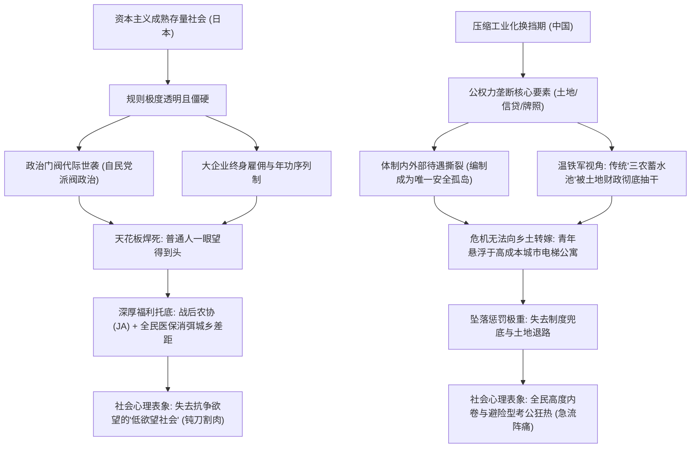
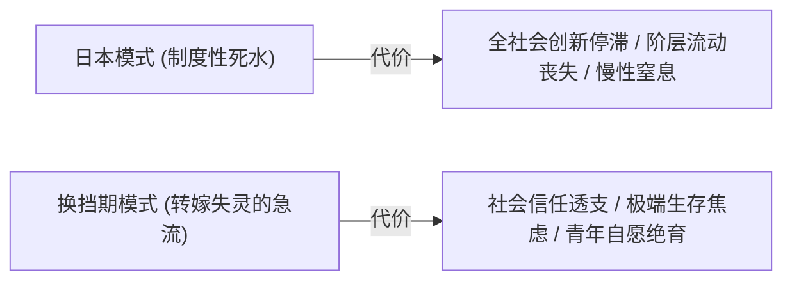

在探讨当代东亚社会的青年困境时，公众舆论往往习惯将中日两国的“年轻人躺平”、“低欲望”、“考公热”与“贫富差距感”一锅端地归咎于模糊的“内卷”。

然而，如果结合温铁军在《新中国十次周期性经济危机》中对“国家资本原始积累与制度成本转嫁机制”的宏观解构，将两国的阶层结构与制度土壤切开观察，两者的阶层固化虽然在表象上有不少相似之处，但**其形成的底层逻辑、利益流动机制与社会代价截然相反**：

一个是经历了三十年经济停滞、工业化高度成熟、在和平演进中自我锁死的**“存量制度性板结”**；另一个则是在四十年压缩型工业化换挡期、公权力支配核心要素资源、且**“向农村转嫁危机成本的弹性蓄水池彻底失效”后的“垄断型收缩固化”**。

---

### 一、 机制分野：存量板结 vs 要素垄断与转嫁失灵

```text
+-------------------------------------------------------------------------+
|                        中日阶层固化底层机制对比                         |
+-------------------+-----------------------------------------------------+
| 比较维度          | 日本社会 (存量板结)           | 中国社会 (要素垄断与转嫁失灵)|
+-------------------+-------------------------------+---------------------+
| 形成土壤          | 工业化极度成熟后的财富存量恒定| 压缩工业化换挡期，公权力支配要素分配|
+-------------------+-------------------------------+---------------------+
| 向上通道          | 门阀垄断政界，企业按资排辈    | 高考选拔回报递减，编制与核心岗位代际传递|
+-------------------+-------------------------------+---------------------+
| 寻租形态          | 高度体制化、延期合法化 (天下り)| 绝对自由裁量权寻租，全链条覆盖      |
+-------------------+-------------------------------+---------------------+
| 危机缓冲垫层      | 极高公共福利兜底 (医保/年金)  | 历史上依赖"三农蓄水池"；如今缓冲垫瓦解|
+-------------------+-------------------------------+---------------------+
| 流动受阻痛感      | 钝刀子割肉 (窒息感、无力感)   | 急刹车阵痛 (剧烈焦虑与无处可退的恐慌)|
+-------------------+-------------------------------+---------------------+
| 规则确定性        | 极高 (预期明确，难以逾越)     | 政策与周期波动大，不确定性强        |
+-------------------+-------------------------------+---------------------+
```



---

### 二、 日本社会的制度性板结与迂回腐败

很多人误以为“低欲望社会”是日本年轻人的自发觉醒，但**“低欲望”本质上是经济长期停滞与阶层固化共同压榨出来的应激副产品**。

掌握核心资源与权力的政治家族、财阀高层，从来不在低欲望群体之列。日本的腐败并非表现为发展中国家常见的公职人员直接索贿，而是发展成了一套极其精密的制度性合谋：

#### 1. 门阀政治与世袭网络
- 日本国会议员中，“世袭议员”（祖父辈或父辈即为议员）的比例在自民党长期执政时期常年高达 30% 至 40%，首相与内阁核心大员（如安倍、麻生、小泉、岸田家族）几乎全由门阀把持；
- 政治献金、选区后援会组织与资金网络被合法地在家族内部代际传递，平民阶层通过正常竞选打破政治天花板的概率微乎其微。

#### 2. “天下利权”（天下り）的延期利益输送
- 日本高级职业官僚（霞关精英）在退休后，会由人事网络安排进入曾经受其监管的大型私营财团、公营企业或半官半民的行业协会担任高级顾问或社长；
- 这种机制表面上完全合法，不产生直接金钱索贿，但构成了**合法化的延期受贿与政商游说通道**：在任期间制定有利于大财阀的规制条款，退休后享受高额退休金与咨询费供养。

#### 3. “谈合”（串标）文化与公共预算分赃
- 在建筑、交通、大型防灾设施等公共基建工程中，企业间在官僚默许下长期存在事前协商配额机制；
- 参与竞标的企业轮流以预定价格中标，杜绝恶性价格竞争，以此维持行业寡头的垄断利润。其代价是由全体纳税人买单，推高了公共工程成本。

#### 4. 自民党派阀政治的“里金”机制
- 派阀政治的维系依赖巨额竞选补贴与运作资金；
- 派阀向所属议员分配筹款宴会券配额，超出配额的巨额资金被系统性截留、不计入法定政治资金收支报告书，形成供派阀领袖与议员自由支配的“黑金（里金）”。

#### 5. 战后农业基本盘的兜底保护
- 值得注意的是，日本在战后麦克阿瑟主导的农地改革中彻底消灭了地主阶层，并通过自民党与“全国农业协同组合（农协 JA）”的政治同盟，给予农民极高的农产品关税保护与财政补贴；
- 偏远县镇的基础设施、医疗和学校水准与东京相差无几，蓝领与农民收入受制度刚性保护。这使得日本的阶层板结虽然沉闷，但底层始终拥有稳固的物质底线。

---

### 三、 换挡期的垄断型收缩与“转嫁蓄水池”的终结

相比于日本高度成熟但板结的稳态，中国社会在由高速扩张转向中低速换挡期时，其阶层固化表现出完全不同的运作机制。

温铁军在总结新中国十次周期性经济危机时指出：**中国前几十年的工业化能够屡次度过危机，核心法宝在于城乡二元结构充当了“制度成本转嫁的蓄水池”**。但今天，这套缓冲机制已彻底走向终结：

```mermaid
flowchart TD
    subgraph 历史上的三次危机转嫁软着陆 (温铁军范式)
        A["1960年三年困难 / 工业停摆"] -->|1200万城市劳动力| B["下放农村，由集体化土地自给吸纳"]
        C["1968年文革动乱 / 工厂瘫痪"] -->|1700万知青上山下乡| D["将城市失业危机排毒至广袤农村"]
        E["1997年亚洲金融危机 / 工业下岗"] -->|2000万农民工回流| F["返乡种地，家庭自给消化失业冲量"]
    end

    subgraph 当代蓄水池失效后的硬着陆陷阱
        G["2020年代换挡期增速下滑"] --> H["土地财政把农村与郊区土地资本化抽干"]
        H --> I["两代农转非青年失去土地自耕自足能力"]
        I --> J["上千万大学毕业生只能滞留城市争抢编制"]
        J --> K["无处可退的硬着陆: 阶层坠落恐慌触发极致内卷"]
    end
```

#### 1. 要素资源的行政绝对垄断与自由裁量
- 中国的公权力掌控着土地拍卖、国有银行信贷投放、战略行业特许经营权（能源、通信、基建、医药）与重点项目审批的总闸门；
- 当权力掌握要素分配权却缺乏透明的外部法律与舆论制衡时，权钱兑换极其直接与普遍。从地方城投平台发债、土地出让，到微观的就医入学、工程转包，寻租成为最硬的商业壁垒。

#### 2. 特权阶层的代际排他性传承
- 在垄断性国企与核心体制内岗位中，裙带关系与排他性网络使得核心资源代际传递现象显著；
- 普通草根家庭子弟即便通过残酷的高考选拔考入名校，在步入社会面对体制内外资源分配、信用贷款与关键晋升时，依然会被隐形的关系壁垒阻隔。

#### 3. “三农蓄水池”的瓦解与青年的悬浮绝境
- **过去危机的软着陆秘密**：正如温铁军所论证的，1960年的财政赤字危机靠动员千万职工下乡化解；1968年城市工厂失业危机靠知识青年上山下乡转嫁；1997年外需暴跌靠数千万农民工返乡自耕消化。广阔的乡土和传统家庭是中国承受周期震荡的最大气囊；
- **当下的致命死局**：过去三十年的“土地财政”与激进城市化，把广袤农村的土地和劳动力剩余价值抽取殆尽。二代、三代青年彻底脱离了农耕生产技能，农村沦为空心化废墟；
- 当代青年被彻底格式化为**高负债、高生活成本、悬浮在城市电梯公寓里的“纯成本人口”**。当经济周期下行、体制外大厂裁员时，他们已经“无地可退、无田可耕”；
- 底层缺少坚实的公共托底网络，又失去了历史上的乡土蓄水池。掉落底层的代价是直接面临生存断崖，这正是“考公狂热”与全社会精神焦虑达到顶峰的根本原因。

对此，翟东升在《平行与竞争：双循环时代的中国治理与国际秩序》（东方出版社，2021年）中曾切中要害地指出：**构建以内循环为主体的新发展格局，最深层的体制梗阻在于国民收入初次分配严重失衡**。中国居民可支配收入占 GDP 比重长期显著低于全球主要经济体均值，资本回报与行政税费拿走了过大份额，导致微观居民部门长期“能生产而无力消费”。当土地、资本与编制要素被体制垄断并转化为少数特权群体的制度性租金时，不仅内需大循环无法有效自发造血，更为整个社会的微观青年个体套上了沉重的隐形发展枷锁。

---

### 四、 结语：两种不同的社会代价



两者的固化呈现出不同的社会形态与时代代价：

- **日本是“下限极高的死水”**：你几乎跳不出原来的池子，阶层通道死死锁住；但无论你在哪个池子里，基本都能温饱、体面且安全地过完一生。其代价是全社会的创新停滞、制度缺乏纠错活力与弥漫全域的低欲望。
- **换挡期是“转嫁失效后的存量急流”**：过去赖以向农村转嫁危机成本的体制弹性彻底枯竭，体制内外待遇鸿沟急剧拉大。落入底层的代价极为沉重，普通人被迫在体制避风港（考公）中避险，或以绝育和躺平进行无声抵抗。

正如翟东升在《中国为什么有前途》（第3版，机械工业出版社，2019年）中所展望：大型后发经济体要跨越中等收入陷阱、释放工程师红利的战略潜能，其唯一钥匙在于**打破行政垄断带来的要素错配，推动收入分配向广大劳动者与创新者倾斜**。

当社会的资源分配权被权力绝对垄断，而历史上的危机转嫁蓄水池彻底干涸时，阶层固化就不再只是统计学上的基尼系数，而是转化为每一位普通人骨髓里的生存重压。

---

### 参考文献与延伸阅读

1. 温铁军. 新中国十次周期性经济危机[M]. 北京: 东方出版社, 2013.
2. 翟东升. 平行与竞争: 双循环时代的中国治理与国际秩序[M]. 北京: 东方出版社, 2021.
3. 翟东升. 中国为什么有前途[M]. 3版. 北京: 机械工业出版社, 2019.
