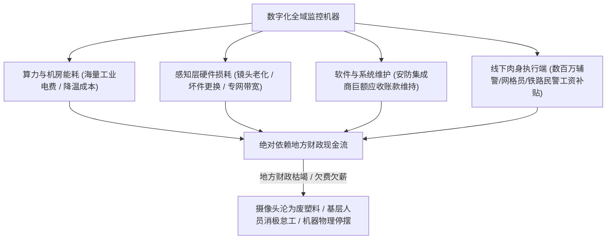
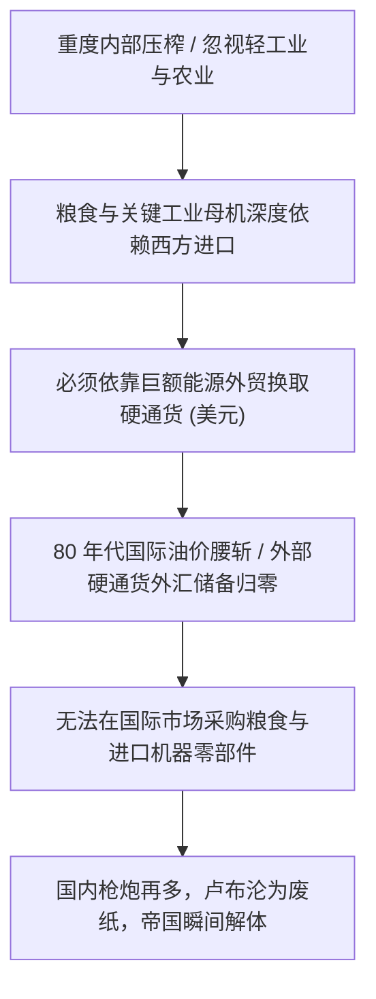

在探讨庞大帝国或极权体制的寿命时，一种流传甚广的经验直觉认为：“只要国家机器掌握着绝对暴力，手里拥有几亿不敢反抗的顺民，它就可以靠无限制的压榨和内部收割万世不竭。”

然而，结合温铁军在《新中国十次周期性经济危机》中对新中国前几十年如何度过财政危机的历史解剖，便能看清一条冷酷的客观规律：**所有看似固若金汤的庞大帝国，最终都不是被挺直了腰杆的底层人民自下而上推翻的，而是被数学规律与物理规律活活耗死的。**

过去中国数次从经济崩溃边缘幸存，全靠一套特定的“向农村软着陆转嫁成本”机制。当这个排毒通道彻底关闭、国家机器自身的物理能耗账单膨胀至天文数字时，体系走向终局的致命死穴，永远是**财政现金流的断流与物理意义上的能量衰竭**。

---

### 一、 温铁军视角：前四十年危机软着陆的真实排毒通道

为什么新中国在过去几十年遭遇了十次严峻的周期性经济危机（从50年代苏联撤援赤字、60年代三年困难、70年代四三方案外债危机，到1988年通胀、1997年下岗），却没有像苏联那样轰然解体？

温铁军给出的答案极其深刻：**因为中国历史上拥有一个世界上绝无仅有的超大型危机蓄水池——自给自足的传统农村与小农家庭。**

```mermaid
flowchart TD
    subgraph 过去危机的软着陆排毒机制 (温铁军范式)
        A["城市工业化爆发严重债务 / 财政 / 失业危机"] --> B["国家机器启动城乡二元体制"]
        B --> C["知青上山下乡 / 职工精简回乡 / 农民工返乡自耕"]
        C --> D["传统小农土地与家庭包容失业人口 (零财政福利成本)"]
        D --> E["城市工业与财政实现软着陆脱困"]
    end

    subgraph 当代排毒通道的彻底关闭
        F["土地资本化抽干农村剩余 / 乡村空心化废墟"] --> G["两代农转非青年失去回村种田的技能与土地"]
        G --> H["数千万失业青年被死死焊死在城市电梯公寓"]
        H --> I["危机无法向外转嫁 / 财政赤字与失业压力全额在城市积聚"]
    end
```

- **知识青年上山下乡的经济本质**：1968年文革动乱导致城市工商业瘫痪、1700万初高中毕业生在城市无法就业。如果滞留城市，必将引爆恶性社会动荡。毛泽东一声号令“上山下乡”，本质上是用行政动员把城市的财政赤字与失业危机，直接甩给广袤农村的生产队自负盈亏；
- **排毒通道彻底关闭的历史变局**：过去三十年的激进城市化与“土地财政”，把农村的土地资本化抽干，农民工二代三代彻底失去了农业生存技能。**当今天的经济周期再次面临就业寒冬与财政亏空时，体制再也没有一个可以接盘数千万失业年轻人的农村蓄水池了**。危机必须在城市地表全额承受硬着陆。

---

### 二、 “普天之下莫非王土”的前现代占有迷思

把“拥有九百六十万平方公里土地 + 十四亿人口”等同于“可以无限变现、无限兜底的超级资产”，在帝王术和政治宣传上逻辑自洽，但在现代金融与货币运行的现实中，存在致命的认知错位：

```text
+-------------------------------------------------------------------------+
|                  负债型占有资产 vs 国际流动性净资产对比                 |
+-------------------+-----------------------------------------------------+
| 比较维度          | 封闭境内不动产与人口          | 国际通用硬通货生息资产 |
+-------------------+-------------------------------+---------------------+
| 国际变现能力      | 趋近于零 (沙特不收大山换石油) | 极高 (全球自由市场秒级竞价结算)     |
+-------------------+-------------------------------+---------------------+
| 现金流属性        | 耗损型 (需持续财政输血维持运转)| 造血型 (每年稳定获取外汇利息与分红) |
+-------------------+-------------------------------+---------------------+
| 老龄人口属性      | 刚性支出负债 (医疗/养老/维稳) | 资本市场不承担人身供养包袱          |
+-------------------+-------------------------------+---------------------+
| 抵押清偿能力      | 外部危机时无法转化为国际清偿力| 随时可抛售救汇率、买战略资源        |
+-------------------+-------------------------------+---------------------+
```

1. **不可跨国变现的沉没成本**：
   - 国际大宗商品交易只认全球流通的硬通货（美元、黄金）。中东卖家绝不接受用内陆荒漠或地方城投公路换原油，巴西也不接受用三四线城市的法拍房抵扣大豆；
   - 崇祯皇帝拥有整个大明江山和数千万子民，论地盘和人口是当时全球顶级帝国。但当面对美洲白银流入减少引发通缩、国库空虚、李自成兵临城下时，崇祯连几十万两给守城将士发饷的银子都拿不出来。**“拥有天下”在转化为即时国际清偿与硬通货支付能力时，往往是完全失灵的。**
2. **人口不是纯利润，在衰老期是沉重负债**：
   - 十四亿人不是堆在仓库里的生铁，他们每天要消耗粮食、需要医疗、需要养老、需要教育。当人口红利演变为深度老龄化时，人口是财政每天必须真金白银贴钱维持运转的无底洞。

---

### 三、 现代数字化极权的天价物理账单

很多人以为，有了数亿个高清摄像头、AI 人脸识别、健康码/购票风控系统，现代社会的统治成本比清朝更低。

事实恰恰相反：**这套全域精准监控的现代法家机器，其物理维持账单贵得惊人**。

```text
+-------------------------------------------------------------------------+
|                      清朝维稳成本 vs 现代数字化维稳成本                 |
+-------------------+-----------------------------------------------------+
| 比较维度          | 清朝的"腰刀与黄册"            | 现代"AI + 摄像头 + 大数据风控"      |
+-------------------+-------------------------------+---------------------+
| 核心技术载体      | 纸质户籍、保甲木牌、冷兵器    | 高清传感器、GPU服务器、光纤专网、云平台|
+-------------------+-------------------------------+---------------------+
| 日常能耗与折旧    | 几乎为零 (官府不给保甲长发钱) | 每天燃烧天量工业电费、硬件3-5年折旧 |
+-------------------+-------------------------------+---------------------+
| 供应链外部依赖    | 铁匠铺与毛笔造纸，完全自给自足| 先进制程芯片、精密算法框架深度依赖外部|
+-------------------+-------------------------------+---------------------+
| 肉身执行群体      | 极少量的衙役、绿营 (占人口微弱)| 千万级的网警、辅警、安检员、网格员  |
+-------------------+-------------------------------+---------------------+
| 财政断流后果      | 衙役回乡种地，社会退回宗族自治| 设备一年内大面积黑屏，机器瞬间物理瘫痪|
+-------------------+-------------------------------+---------------------+
```



1. **每天燃烧的电费与算力折旧**：
   - 视频流要实现全网人脸毫秒级比对检索，需要成千上万张企业级高性能 GPU 昼夜运算；
   - 一座省部级政务大数据中心每年的工业电费与制冷费用，足以吞噬一个贫困县一年的全口径财政收入；
   - 翻开过去几年安防企业的财报，满纸都是地方政府拖欠的数百亿应收账款。
2. **机器终究需要活人充当肉身终端**：
   - 车站闸机秒级锁死，只是发出了警报；在闸机前把你按在地上、连夜押解回原籍、在小区门口 24 小时排班蹲守的，必须是活生生的人；
   - 辅警、网格员、协管员每天要领工资还房贷、养家糊口。当地方财政亏空导致辅警降薪欠薪、警车加不起油时，执法人员就会理智地选择“睁一只眼闭一只眼”或消极怠工。

---

### 四、 苏联解体的真实物理死因：外汇断流而非兵力不足

苏联当年的体制完全满足了极权神话的所有假设：
1. 占领全球六分之一的陆地，手握近三亿受过良好高等教育的人口；
2. 契卡与克格勃对内控制登峰造极，想抓谁去古拉格挖煤就抓谁；
3. 拥有完整的重工业体系、两万辆坦克与数以万计的核弹头。



- 按照“只要对内无限收割、手里有枪就能千秋万代”的逻辑，苏联应该永远不倒；
- 但由于轻工业与农业在过度压榨下彻底瘫痪，苏联必须向欧美买小麦来喂饱国民、买关键设备来维持油气开采；
- 当八十年代国际油价暴跌、苏联手里的**外汇储备彻底见底**时，国内的核弹头再多、克格勃再严酷，也没法用卢布从国际市场上买回一斤粮食；
- **最后击垮一个庞大帝国的，从来不是老百姓敢不敢造反，而是手里的内部收割工具，在外部硬通货断流面前彻底退化成了废纸。**

正如翟东升、嵇先白、魏子龙在《制裁与经济战：国力碰撞的大争之世，中国如何把握主动》（中国人民大学出版社，2025年）中所系统梳理的冷战经济战案例：西方针对苏联的全面战略封锁，最致命的杀招绝非军事对峙，而是**“硬通货外汇流动性绞杀与尖端工业折旧封锁”**。里根政府通过联合沙特压低国际油价，直接腰斩了莫斯科 70% 以上的外汇硬通货造血来源；同时借助巴黎统筹委员会（COCOM）进行严密的技术与精密机床禁运。一个丧失了外部硬通货流动性造血与关键零部件补给的重工业巨兽，其庞大资产在物理折旧与粮食短缺的重压下，瞬间沦为加速体制瓦解的净负债。

---

### 五、 极权体系的热力学熵增定律

在物理学中，没有任何封闭系统可以打破热力学第二定律：

1. **自发秩序的低能耗**：市场经济、民间自治与法治社会依靠自发的契约和价格信号协调，维护成本极低，社会具有自我造血与自我修复能力；
2. **极权控制的能量黑洞**：要把十四亿人的复杂现代社会强行塑造成“绝对服从的单一意志”，就必须在每一个毛细血管处投入巨大的能量去对抗社会的自发离心力（海量的网格员、算法审查、巡视组、纪检暗哨）；
3. **不可逆的内耗自噬**：控制的粒度越细，系统消耗的能量呈几何级数暴增。**当维稳机器所消耗的资源，最终超过了被统治者所能生产的剩余价值总和时，整个系统就进入了不可逆的内耗自噬期。**

在《中国为什么有前途》（第3版，机械工业出版社，2019年）中，翟东升教授从国家战略潜能的角度论证过全要素生产率（TFP）的本质：任何大型经济体若想跳出历史兴衰周期，必须依靠微观主体的技术创新、要素自由流动与开放包容的国内统一大市场。倘若反其道而行之，以行政管制彻底锁死市场神经，将资源源源不断抽调至低效的维稳与僵尸重资产领域，不仅无法维系可持续的财政造血，反倒会使全要素生产率陷入断崖式失速，加速滑向热力学熵增的临界点。

---

### 六、 结语

清朝的皇帝不需要考虑电网瘫痪、不需要考虑显卡断供、不需要考虑每年数万亿的安防运维预算。而现代数字化极权机器，却把自身的存在彻底绑定在了一个极其昂贵、脆弱的现代高科技工业网络之上。

结合温铁军对十次危机的终局剖析：过去统治者依靠“向农村排毒”的制度红利已经彻底耗尽。

这套系统从来不是怕人民反抗，它唯一的致命敌人，是**地方财政库房里那见底的数字**。当财政的燃料耗尽、外部的硬通货断流、打手的饷银再也发不出来的那一天，墙上那数亿个黑洞洞的高清摄像头，就只会是一堆挂在高处的废塑料和坏玻璃。

---

### 参考文献与延伸阅读

1. 温铁军. 新中国十次周期性经济危机[M]. 北京: 东方出版社, 2013.
2. 翟东升, 嵇先白, 魏子龙. 制裁与经济战: 国力碰撞的大争之世, 中国如何把握主动[M]. 北京: 中国人民大学出版社, 2025.
3. 翟东升. 中国为什么有前途[M]. 3版. 北京: 机械工业出版社, 2019.
