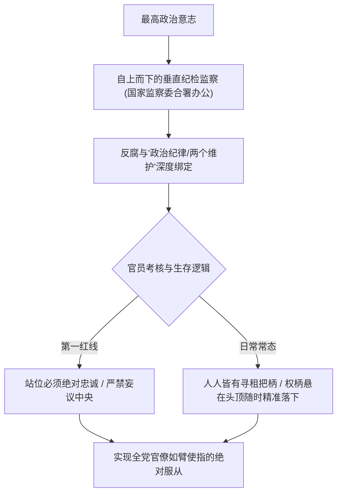
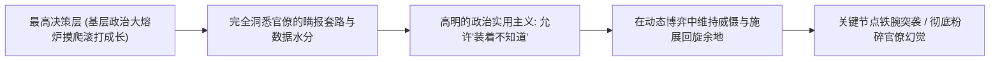

民间常有一句振聋发聩的警言：“反腐亡党，不反腐亡国”。这句话精准道破了当代中国政治治理中最核心的体制命门。

西方自由派学者常常开出廉政药方：“为什么不搞司法独立？为什么不搞官员财产公示（阳光法案）？为什么不放开新闻调查和跨党派监察？”

**这些在西方被奉为圭臬的现代制度，对执政党而言无异于政治自杀。**

搞司法独立等于让法官凌驾于党委之上；搞财产公示会瞬间曝光数千万体制内阶层的巨额财富撕裂，直接引爆合法性雪崩；放开媒体监督等于亲手拆除意识形态护城河。最高决策层极其清醒地拒绝了这一切西方特洛伊木马，而是选择将反腐升华为一套**纯粹的政治规训工具与忠诚度检验权杖**。

---

### 一、 反腐的真实定位：权力清洗与绝对忠诚的达摩克利斯之剑

反腐从来不是请客吃饭，也绝非西方意义上的“技术性道德反贪”。在高度集权体制下，**反腐是巩固领袖绝对权威、清除政治异己、强化组织纯洁性的最高手段**：



1. **绝对权力下的把柄治官**：
   - 在公权力高度支配土地、金融、审批和财政拨款的环境下，地方官僚在发展经济过程中几乎不可能做到百分之百的廉洁。每个人手里都攥着灰色地带的把柄；
   - 规则的解释权牢牢收拢在最高层手中：抓谁、不抓谁、何时启动调查、定性为违纪还是违法，完全取决于政治忠诚与大局需要。这种不确定性，构成了震慑整个官僚体系最有效的达摩克利斯之剑；
2. **“自我革命”的逻辑闭环**：
   - 体制绝不允许任何外部中立力量插手监督。从中央巡视组、中纪委到各级监察委，全部是先锋队最高意志的纵向延伸。反腐的过程，就是不断敲打官僚队伍、重塑纪律服从的过程。

---

### 二、 官僚生态的南北分野与中央集权的绝对统摄

很多人观察到官僚体系内部的鲜明生态：“北方官僚普遍选择形式主义和躺平避责，而南方官员往往还想做点事情、搞活经济”。

这种地域差异真实存在，但其背后的政治演进却是在中央集权的绝对意志下被全面收拢：

```text
+-------------------------------------------------------------------------+
|                        北方官僚模式 vs 南方官僚模式对比                 |
+-------------------+-----------------------------------------------------+
| 观察维度          | 北方官僚生态                  | 南方官僚生态 (沿海务实派)           |
+-------------------+-------------------------------+---------------------+
| 核心行为策略      | 政治表态极度激进，实际工作躺平| 善于政策变通，注重民营经济与商业招商|
+-------------------+-------------------------------+---------------------+
| 激励诉求          | 避责免责第一，严控各类安全事故| 做大地方经济蛋糕，追求实际政绩      |
+-------------------+-------------------------------+---------------------+
| 中央统摄路径      | 依赖转移支付，完全听从行政指令| 抽调财政盈余，巡视与合规利剑全面压制|
+-------------------+-------------------------------+---------------------+
| 终局收敛          | 形式主义空转                  | 务实空间被压实，向中央统一意志看齐  |
+-------------------+-------------------------------+---------------------+
```

- **发展主义激励的收口**：改革开放前三十年，地方官员化身“地方政府公司”董事长，在招商引资中大显身手；但今天，政治站位优先压倒了一切经济变通。南方官员即使想扶持企业，也必须在中央巡视与一票否决制的红线内行事；
- **财政抽血与绝对掌控**：中央通过统筹调拨沿海省份的财政盈余支援中西部，确保了全国大一统棋局的稳固。任何地方主义或尾大不掉的苗头，都在常态化的政治巡视中被彻底瓦解。

正如翟东升在《平行与竞争：双循环时代的中国治理与国际秩序》（东方出版社，2021年）中所分析的，大国治理的重心已经从过去的效率优先，彻底转向国家安全、政治可控与内生稳定优先。体制宁可承受微观上的部分官僚消极避责，也绝不容忍地方失去中央的绝对号令。

---

### 三、 破除“信息茧房”神话：最高层的马基雅维利通透

西方观察家经常嘲笑最高决策层陷入了官僚织造的“信息茧房”，以为高层被下级的虚假汇报所蒙蔽。这种看法纯属幼稚：



1. **中国人最懂玩政治和意识形态**：
   - 能够在大一统帝国的残酷政治斗争中脱颖而出的核心统治者，无一不是从基层摸爬滚打、深谙人情世故与官僚把戏的顶级马基雅维利大师；
   - 基层汇报注了多少水、失业率怎么美化、地方债怎么隐匿，高层心里比谁都清楚。所谓“不知道”，往往只是在特定时间窗口内**出于政治稳定和战略节奏而选择性“装着不知道”**；
2. **引而不发与伺机整肃**：
   - 容忍局部的灰色，是为了让机器继续运转；而一旦某项政策需要强制推行，账本随时可以翻开，雷霆手段瞬间落地。这种高深莫测的信息与裁决特权，正是最高权力掌控全盘的核心秘密。

---

### 四、 结语

在现代权力的棋局上，不要用西方自由派的温情范式来度量一个成熟的列宁主义大党：

**反腐是清洗肌体、淬炼忠诚的烈火，绝非自掘坟墓的权力妥协。**

通过彻底排斥西方三权分立的毒药，牢牢握紧纪检巡视与绝对裁量权，最高意志将数千万官僚牢牢绑在国家意志的战车上。这套体系深谙中国两千年的官场哲学，在铁腕威慑与实用纵容之间游刃有余地维系着大一统帝国的绝对权柄。

---

### 参考文献与延伸阅读

1. 翟东升. 平行与竞争: 双循环时代的中国治理与国际秩序[M]. 北京: 东方出版社, 2021.
2. 温铁军. 新中国十次周期性经济危机[M]. 北京: 东方出版社, 2013.
3. 翟东升. 货币、权力与人: 全球货币与金融体系的民本主义政治经济学[M]. 北京: 中国社会科学出版社, 2019.