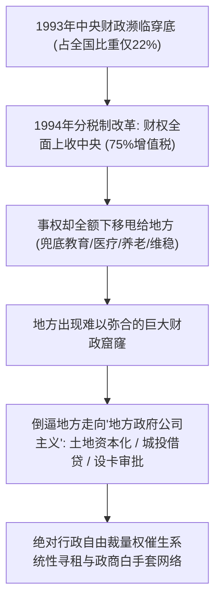
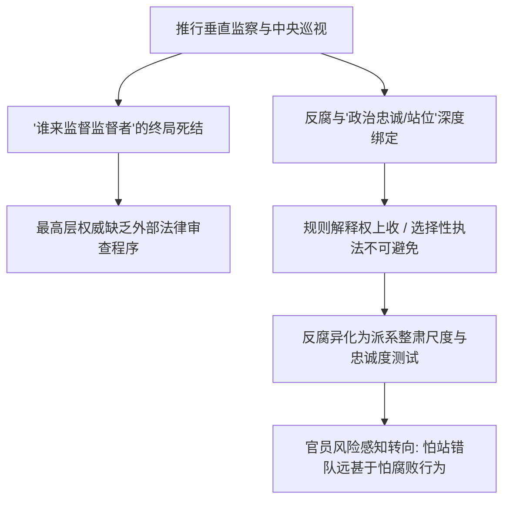
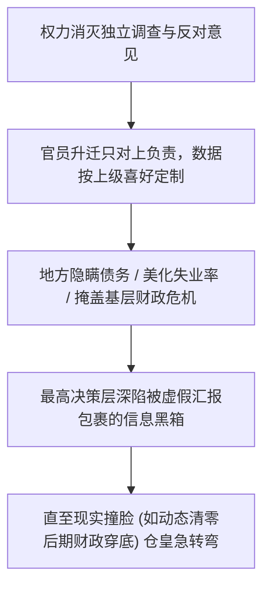

在过去十余年里，官方展开了史无前例的高压反腐：设立国家监察委员会实现监察对象全覆盖、频繁修订《纪律处分条例》、常态化派驻中央巡视组，立案审查处分官员数以百万计。

然而，每年披露的落马官员数量依然处于高位，金融、医药、能源、基建以及军队系统的高层窝案仍层出不穷。这种**“高压制度化建设”与“腐败增量依然难绝”的脱节**，在民间催生了一句广为流传的警言：“反腐亡党，不反腐亡国”。

结合温铁军在《新中国十次周期性经济危机》中对“1994年分税制改革与地方政府公司主义异化”的制度溯源，便能看清：腐败绝非个别官员道德滑坡的孤立现象，而是当代中国宏观财政集权与微观资源配置结构碰撞出的**内生性体制副产品**。

---

### 一、 执政合法性与权力制衡的零和博弈

现代政治学中经过反复验证的廉政机制极其清晰：**分权制衡与外部对冲**——通过独立司法、官员财产公示（阳光法案）、自由新闻调查与跨党派监察来压缩权力的寻租空间。

但对于列宁主义政党而言，推行彻底的现代法治工具无异于开启了政治自杀程序：

```text
+-------------------------------------------------------------------------+
|                  现代廉政制度与威权权力基石的结构性排异                 |
+-------------------+-----------------------------------------------------+
| 现代廉政工具      | 运行机制                      | 对威权体制的致命解构|
+-------------------+-------------------------------+---------------------+
| 独立司法          | 法官只服从法律，不受党委领导  | 抽空"党管一切"根基，法律权威凌驾权力之上|
+-------------------+-------------------------------+---------------------+
| 财产公示 (阳光法案)| 公示全公职人员直系海内外资产  | 曝光历史积累的巨大财富撕裂，引发信任危机|
+-------------------+-------------------------------+---------------------+
| 自由新闻调查      | 媒体独立暗访监督，曝光黑幕    | 打破意识形态垄断，培育不可控的公共议程  |
+-------------------+-------------------------------+---------------------+
| 多党 / 外部监察   | 竞争性政党相互监督纠错        | 形成制度化反对力量，动摇先锋队绝对执政地位|
+-------------------+-------------------------------+---------------------+
```

对最高决策层而言，这些现代廉政制度不是“改良的工具”，而是“颠覆政权的特洛伊木马”。这种无法推行根本性外部监督的体制约束，迫使其必须退守到一条完全相反的路径：**自上而下的垂直列宁主义纪律规训**。

---

### 二、 温铁军视角：1994年分税制与寻租土壤的内生化

为什么过去三十年中国官僚系统的寻租会演变为全域性的系统现象？温铁军在分析第五次经济危机（1993-1994年宏观三角债与财税危机）时指出了核心制度诱因：



1. **财权上收与事权下移的制度裂缝**：
   - 80年代财政包干制导致“弱中央、强地方”，中央财政一度需要向地方借钱度日；1994年分税制改革，中央以强力手段将核心优质税源收归中央，却将无限扩大的公共品支出与维稳事权甩给地方；
2. **土地财政与城投资本化的制度狂欢**：
   - 面对巨大的财政缺口，中央默许地方“以地生财”。地方官员化身为“地方政府公司（Local State Corporatism）”的董事长与总经理，通过垄断土地出让、设立城投平台放大杠杆借贷；
   - 在缺乏独立司法与公众监督的环境下，掌握百亿土地指标、工程发包权、银行信贷分配权的地方主官，拥有了几乎不受约束的**绝对自由裁量权**，权钱交易因而渗透到经济的每一个神经末梢。

---

### 三、 “自我革命”的物理学极限

正因为拒绝外部司法与公众监督，官方提出了“自我革命”——试图证明执政党无需外部制衡，依靠自我刮骨疗毒也能跳出“历史周期律”。

然而，这套自闭环规训违背了基本的政治物理学定律：



1. **主体无法制约自身**：
   - 人无法揪着自己的头发离开地球表面。同一个权力系统内部设立的监察机构，无论级别拔得多高，其人事权、预算权和最终定性权依然受制于同级或上级一把手；
2. **“谁来监督监督者”的终局困境**：
   - 当反腐依靠派驻更高维度的巡视组时，这套机制在逻辑上必然走向终点困境：最顶层的权威由谁来监督？
3. **忠诚度测试冲淡制度刚性**：
   - 当反腐与“政治纪律”、“两个维护”深度绑定时，贪腐问题往往与政治站位交织在一起。官员感知到的核心风险不是“客观上的贪腐行为”，而是“站错队或不听话”；规则缺乏程序正义与公开辩护空间，成了不可预测的达摩克利斯之剑。

---

### 四、 制度化落地的副产品：“公司主义动力熄火”与避责型官僚

严苛的内部规训在没有理顺中央与地方财税关系、没有放开要素市场化竞价的情况下推行，直接摧毁了过去三十年推动经济狂奔的**微观官僚激励机制**：

```text
+-------------------------------------------------------------------------+
|                  发展主义时代 vs 强监管高压时代的官僚激励对比           |
+-------------------+-----------------------------------------------------+
| 维度              | 发展主义时代 (地方公司主义)   | 强监管高压时代 (纪律规训) |
+-------------------+-------------------------------+---------------------+
| 核心驱动力        | 招商引资、卖地搞基建拿政绩    | 政治表态绝对正确，不出事故以求免责  |
+-------------------+-------------------------------+---------------------+
| 地方财政来源      | 土地出让金狂飙 + 城投平台借债 | 土地流拍、债务暴雷、转移支付受限    |
+-------------------+-------------------------------+---------------------+
| 实际行动策略      | "法无禁止即可为"，敢于冒险变通| "法无明文不敢动"，层层请示推诿躺平  |
+-------------------+-------------------------------+---------------------+
| 系统运行状态      | 高效激进，伴生严重寻租腐败    | 形式主义泛滥，公权力陷入空转内耗    |
+-------------------+-------------------------------+---------------------+
```

- **公司主义引擎熄火**：温铁军曾生动指出，改革开放前期的奇迹在很大程度上依赖地方官员像企业家一样“抓招商、拼GDP”。在高压反腐下，官员既失去了隐性灰色收益，又面临“终身追责”的严苛问责风险；
- **最安全的策略是“表态激进、工作躺平”**：大量官员将精力消耗在形式主义党建学习、开会留痕与层层文牍中以求免责，实际经济行政效率大幅下降；
- 高层不得不反复强调“不能躺平”、“要担当作为”，甚至用纪律处分来整治“不作为”，导致官僚体系陷入**“越抓越僵、越僵越抓”**的形式主义恶性循环。

翟东升在《平行与竞争：双循环时代的中国治理与国际秩序》（东方出版社，2021年）中针对这一治理困局展开过深入剖析：**国家治理现代化必须解决“激励相容”的系统问题**。在传统以地方竞争为引擎的发展阶段，体制依靠隐性利益与政绩晋升双重驱动官员的“企业家精神”；而在合规高压全面收紧但并未建立公开透明薪酬体系与要素市场定价的转型期，官员面临“做多错多、不做无责”的收益风险极度不对称，理性策略必然退化为**“以极端的政治合规姿态掩盖实质性的经济不作为”**。当整个官僚神经系统充斥着避责式惰政时，政策执行在纵向传导中便大面积衰减为表态式的空转。

---

### 五、 信息茧房的形成：权力绝对化必然伴随全盲

当制度消灭了一切独立的外部监督、惩罚了所有讲真话的声音时，整套官僚机器的唯一生存法则变成了：**下级对上级精准投毒，只报喜不报忧**。



- “装不知道”最终必然演化为“真不知道”。正如三年自然灾害时钱学森论证“亩产万斤”与各省瞒报，动态清零后期全国地方财政逼近穿底、方舱欠款累累但汇报永远是坚决可控；
- 当官僚系统的考核只对上负责时，信息流被物理污染不可避免。最高决策层在信息学上退化成了双眼全盲的被动者。

---

### 六、 结语

如果将反腐制度化狭隘地理解为“更严密的内部监视、更残酷的刑罚、更集中的控制”，而始终拒绝触碰**“限制行政绝对自由裁量权、改革中央与地方分税财政体制、推行司法独立与全社会公开透明”**的核心命题；

那么，这种制度化就永远无法将权力真正关进制度的笼子，而只能不断加筑关押违纪官员的笼子，并在内部制造出一个人人自危、集体躺平与信息失真的空转机器。

---

### 参考文献与延伸阅读

1. 温铁军. 新中国十次周期性经济危机[M]. 北京: 东方出版社, 2013.
2. 翟东升. 平行与竞争: 双循环时代的中国治理与国际秩序[M]. 北京: 东方出版社, 2021.
