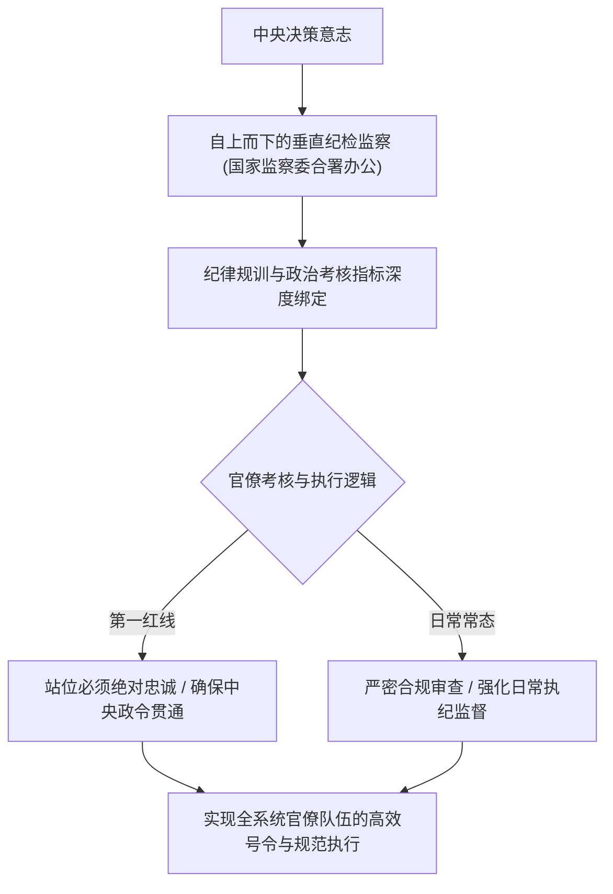

民间常有一句流传甚广的警言：“反腐亡党，不反腐亡国”。这句话直观反映了当代政权治理面临的制度性平衡难题。

部分西方观察家常开出外部制约药方：“为何不照搬司法独立、财产公示（阳光法案）以及完全放开新闻监督？”

**这些在西方代议制下运行的制度工具，与先锋队政党的执政逻辑存在根本性结构排异。**

司法独立要求法律凌驾于党管一切之上；全员财产公示在财富积累历程中极易诱发社会信任震荡；放开完全不受控的媒体监督则会动摇主流意识形态护城河。因此，决策层坚定排除了西方制度方案，选择将自我监督作为**自上而下的垂直组织规训与纪律整饬的核心抓手**。

---

### 一、 纪律规训的治理定位：组织纯洁性与统一执行力

在高度集中统一的治理体制下，**强力反腐不仅是纠治经济违规行为的需要，更是强化组织向心力、维护集中统一号令的关键手段**：



1. **绝对主导下的组织把控**：
   - 在公权力深度支配土地、金融信贷、项目审批与财政转移支付的环境中，地方官员在发展经济的过程中普遍面临复杂的政商边界；
   - 执纪问责的主导权集中于上级组织：合规审查的节奏、范围与定性，直接体现了组织纪律的刚性要求。这种穿透式的问责机制，对庞大的公务人员队伍构成了持续的制度震慑；
2. **“自我革命”的内部制度化**：
   - 体制坚持党内监督为主导。通过中央巡视、派驻监督与国家监察委的常态化运转，将纪律处分转化为定期整顿队伍、统一思想路线的常规化治理机制。

---

### 二、 科层生态的区域差异与中央集权的统一协调

不少学者关注到官僚科层内部的区域治理特征：“北方地区官员相对更看重形式合规与程序避责，而东南沿海干部在传统上更注重务实招商与经济活力”。

这种治理风格的差异客观存在，但在强化集中统一领导的演进中逐步走向规范统一：

```text
+-------------------------------------------------------------------------+
|                        北方科层特征 vs 南方科层特征对比                 |
+-------------------+-----------------------------------------------------+
| 观察维度          | 偏内陆与北方科层风格          | 东南沿海科层风格                    |
+-------------------+-------------------------------+---------------------+
| 行为偏好          | 严守合规程序，偏好稳健避责    | 注重营商环境优化与项目落地实效      |
+-------------------+-------------------------------+---------------------+
| 考核诉求          | 重视底线安全与考核指标达标    | 追求经济增量与民营经济活力          |
+-------------------+-------------------------------+---------------------+
| 协调路径          | 依赖中央统筹调拨与转移支付    | 承担财政上缴职责，在规范框架下履职  |
+-------------------+-------------------------------+---------------------+
| 最终形态          | 程序合规导向                  | 兼顾规范与效能，统一贯彻中央大局部署|
+-------------------+-------------------------------+---------------------+
```

- **发展模式的规范化收口**：过去地方政府依赖土地财政与城投平台展开激进招商竞争；随着债务管控与穿透式巡视落地，经济考核必须让位于高质量发展与风险防范红线；
- **全国一盘棋的财力统筹**：中央通过统筹调用沿海经济大省的财政结余支持中西部基本公共服务，确保了全国大局均衡。各类地方本位主义倾向在常态化监督中得到纠正。

正如翟东升在《平行与竞争：双循环时代的中国治理与国际秩序》（东方出版社，2021年）中所分析的，当前国家治理的核心逻辑已从粗放的唯GDP论，全面转向系统安全、风险可控与国家能力建设。体制对地方科层微观活力的审视，必须服从于宏观统一号令与抗风险大局。

---

### 三、 破除信息遮蔽迷思：决策层的全局掌控力

部分外部评论常断言最高层容易陷入科层汇报编织的“信息盲区”，低估了体制内高级决策者的治理沉淀：


1. **丰富的多层级治理经验**：
   - 核心决策层普遍经历过多层级地方主政与跨系统履职的历练，对基层的实际运转规律、考核博弈与统计折算有着清晰的认知；
   - 基层上报的数据与实际状况的温差，决策体系具备专业的大数据比对、直报机制与明察暗访渠道作为核对交叉参考；
2. **掌握调控的主动权与节奏**：
   - 容许局部的政策过渡期，是维持超大经济体平稳运行的必要弹性；而一旦某项改革进入攻坚期，督察考核与整改问责便会雷厉风行全面落地。

---

### 四、 核心总结

考察大型复杂科层政体的运转，应脱离简单的西方自由主义预设立场：

**自上而下的纪律规训与问责机制，是维系超大国家机器统一运转的内生保障。**

在立足自身基本国情的前提下，通过健全党统一领导、全面覆盖、权威高效的监督体系，最高决策层确保了数千万公职人员队伍在大局战略面前的统一步调与严密执行力。这种治理架构在平衡内部秩序与应对复杂外部挑战中，展现出极强的制度韧性。

---

### 参考文献与延伸阅读

1. 翟东升. 平行与竞争: 双循环时代的中国治理与国际秩序[M]. 北京: 东方出版社, 2021.
2. 温铁军. 新中国十次周期性经济危机[M]. 北京: 东方出版社, 2013.
3. 翟东升. 货币、权力与人: 全球货币与金融体系的民本主义政治经济学[M]. 北京: 中国社会科学出版社, 2019.