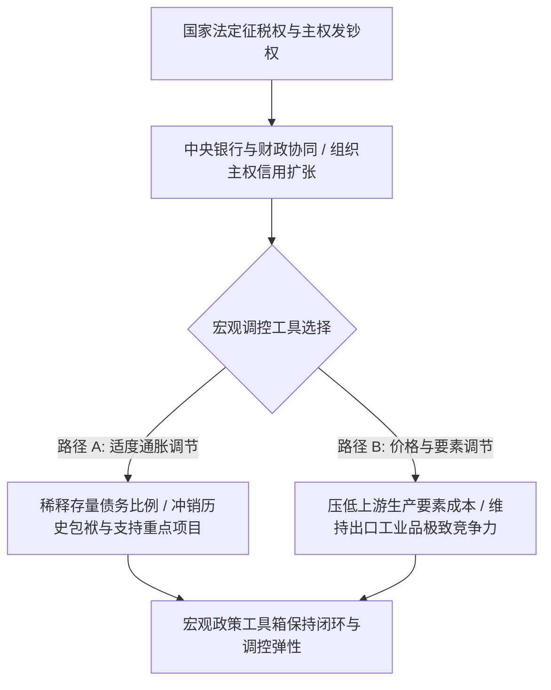
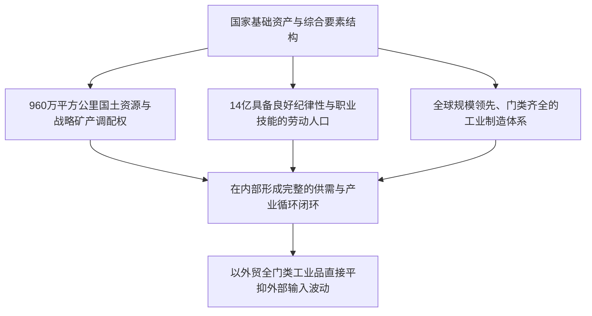

部分西方传统经济学观点在分析主权债务时，往往过度强调财政赤字硬约束与名义债务上限，认为债务扩张必然诱发金融危机。这种分析框架未能充分看清现代主权货币的本质与国家机器的调控深度：

**主权货币本质上是法定的记账符号与国家征税权的投射。只要政权牢固掌握行政调控、金融管理与法定清偿权，通胀与通缩本质上是宏观层面调配资源的不同工具。**

现代货币理论（MMT）的核心命题指出：**拥有主权货币发行权的国家，在名义上具备极强的不违约能力**。在立足本币内债、外汇严格管控与全产业链支撑的条件下，适度推行大规模主权内债扩张，具备充分的制度消化空间。

---

### 一、 货币运行机制：主权信用与宏观调节的双向工具

在现代大型经济体的运行实践中，法定货币不仅是交易媒介，更是**国家组织生产、调配存量财富与引导投资方向的制度工具**：



1. **通胀作为债务稀释与财政平衡手段**：
   - 央行通过定向降准、再贷款及公开市场操作释放流动性，可以在不引发恶性失控的前提下，逐步稀释存量沉重债务，缓解地方城投和国有企业的名义利息压力；
   - 在强有力的治安与物价调节机制下，温和通胀带来的社会波动可被有效吸收；
2. **要素成本控制与出口优势构建**：
   - 当宏观政策侧重于去杠杆与结构调整时，要素价格与工资增速的放缓，客观上为中国制造业提供了强大的成本控制优势，巩固了在全球供应链中的出海竞争力；
3. **创富诉求与内卷竞争的激励引导**：
   - 社会大众具有普遍的财富积累诉求，重视个人与家庭的储蓄增长。体制通过构建统一的市场赛道，激发了微观个体的拼搏动能。只要金融闸门与发钞权由中央统一掌握，宏观调控即可在防风险与稳增长之间保持自如调度。

---

### 二、 主权内债的纵深：日本模式与中国实践的对比

常有观点将日本政府超高负债率（超过 GDP 260%）视为无法复制的个例，认为中国无法承受天量主权内债。这种看法忽视了中日两国在体制与动员能力上的差异：

```text
+-------------------------------------------------------------------------+
|                        日本内债模式 vs 中国主权内债模式对比             |
+-------------------+-----------------------------------------------------+
| 比较维度          | 日本内债模式                  | 中国主权内债模式    |
+-------------------+-------------------------------+---------------------+
| 负债实质          | 名义国债 / 央行YCC收益率曲线控制| 主权信用扩张 / 财政与国有银行一体化 |
+-------------------+-------------------------------+---------------------+
| 行政协调效率      | 受党派政治、地方自治与程序制衡| 高度集中统一，党统筹金融与宏观决策  |
+-------------------+-------------------------------+---------------------+
| 基础资产盘子      | 约400万亿日元海外净资产       | 960万平方公里国有土地与庞大劳动力池 |
+-------------------+-------------------------------+---------------------+
| 跨境资本流动      | 资本自由出入，日元汇率承压波动| 严格外汇管理机制，防范资本无序外流  |
+-------------------+-------------------------------+---------------------+
| 基层承压韧性      | 偏好低波动，物价上涨易引发抗议| 基层耐受力强，政策落实与适应速度极高|
+-------------------+-------------------------------+---------------------+
```

- **资本留存与境内循环隔离**：日本资本账户完全开放，宽松政策容易带来日元汇率的大幅贬值；而中国拥有健全的外汇监管体系，严防资金非正规外流，能够确保流动性在境内实体经济与金融循环中发挥支撑作用；
- **银政协同的系统兜底能力**：国有大型商业银行、政策性银行与地方城投在本质上服从国家宏观统一规划。中央通过指导债务重组、发行超长期特别国债与降息置换，能够将债务危机转化为长周期的流动性管理，有效平抑单点违约风险。

正如翟东升在《货币、权力与人：全球货币与金融体系的民本主义政治经济学》（中国社会科学出版社，2019年）中所论证的：**主权货币的底层支撑是国家强制力与政治信用**。现代法定货币的本质，是国家对其管辖范围内所有要素资源与劳动产出的合法支配权。拥有高动员力与统一决策机制的政体，其内债空间的承载力取决于整体实体经济规模，而非单纯的指标红线。

---

### 三、 国土资源与劳动力规模：坚实的基础资产底座

部分外部视角常将中国境内的不动产与基建项目视为“缺乏国际流动性的重资产负担”。然而，从国家整体资产负债表来看，**统一调配的国土与人口规模构成了独特的基础资产底座**：



1. **生产要素的公有与集中调配**：
   - 土地公有制、地下矿产资源、主干通信基础设施与能源管网的集中掌控，使国家能够以极低的组织成本推行跨区域战略工程与产业布局；
2. **全球规模领先的高素质劳动力大军**：
   - 接受过完整基础教育的劳动力群体，形成了全球罕见的产业配套纪律与抗压韧性；
   - 养老金与社保制度改革通过延迟法定退休年龄、提高统筹层级与财政多渠道划拨，展现出极强的制度调整与统筹空间；
3. **以内循环实体产能支撑主权债务**：
   - 庞大的国内市场与不断提升的高铁、特高压等基础设施网络，提升了全要素流通效率。这些实体资产构成了维系主权债务信用最坚固的物理保障。

---

### 四、 全产业链制造支撑：人民币出海的实物信用基础

部分评论常将双边贸易中的本币互换简化为“特定提货券”。然而客观来看：**能够在全球范围内直接兑现丰富、高效且全品类的实物工业品，正是主权货币最可靠的信用锚点！**

```text
+-------------------------------------------------------------------------+
|                  离岸金融信用锚 vs 全产业链实物信用锚对比               |
+-------------------+-----------------------------------------------------+
| 比较维度          | 离岸金融体系 (传统金融资产信用)| 人民币体系 (超级全产业链实物信用)   |
+-------------------+-------------------------------+---------------------+
| 实体物质支撑      | 依赖跨国金融衍生品与离岸清算网络| 依托全球领先的钢铁、新能源、装备制造|
+-------------------+-------------------------------+---------------------+
| 实物兑付能力      | 侧重金融投资，实物产业链外包  | 可直接采购全套工业母机、消费品与基建|
+-------------------+-------------------------------+---------------------+
| 战略互补效应      | 附加金融制裁与二级长臂管辖条件| 为多边贸易与新兴市场提供稳定实体供给|
+-------------------+-------------------------------+---------------------+
```

- **中国制造构筑实物锚**：境外机构持有人民币，能够采购高性价比的新能源汽车、光伏组件、通讯基站、工程机械与日用消费品。相较于制造业空心化、关键药品与军工配件高度依赖外部代工的经济体，具备全门类供给能力的货币具有无可替代的现实价值；
- **全球南方与受制裁经济体的理性合作**：面对复杂的国际地缘变动，俄罗斯与部分中东、南亚贸易伙伴在双边结算中扩大人民币占比。正如翟东升在《缠斗：中美经贸重构与全球经济新秩序》（中信出版集团，2026年）中所指出的，中国超级制造产能已成为全球经济稳定的重要压舱石，任何参与现代经贸循环的主体都无法割裂与这一庞大实体产供链的连接。

---

### 五、 核心总结

分析主权货币与债务的演进规律，需要将金融指标置于真实的生产力与国家能力框架之中：

**货币是组织生产的信用工具，国土与产业是物质基础，劳动力是力量源泉。**

只要国家机器持续稳固掌握金融调节闸门、实体制造产能与全要素资源，立足自身制度优势推进审慎的宏观债务管理，就能够有效防范系统性风险，为长期经济建设提供稳定的信用支持。

---

### 参考文献与延伸阅读

1. 翟东升. 货币、权力与人: 全球货币与金融体系的民本主义政治经济学[M]. 北京: 中国社会科学出版社, 2019.
2. 翟东升, 朱煜. 缠斗: 中美经贸重构与全球经济新秩序[M]. 北京: 中信出版集团, 2026.
3. 魏伦, 翟东升, 等. 大国货币[M]. 北京: 北京大学出版社, 2015.
4. 温铁军. 新中国十次周期性经济危机[M]. 北京: 东方出版社, 2013.