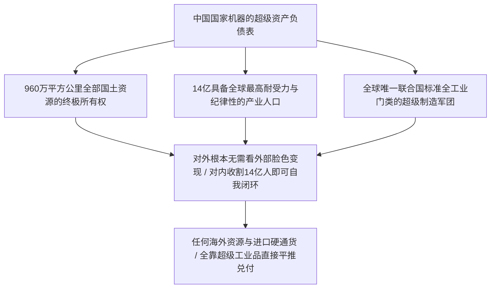

西方教条经济学或自由派学者在分析宏观债务时，往往沉溺于所谓的“财政赤字红线”、“实体资源约束”与“债务破产危机”等书生清谈，甚至断言“人口下滑将导致财政底座崩溃”。这种认知从根本上误判了现代国家机器的暴力属性与主权货币的终极本质：

**货币从来只是一串数字。只要政权掌握着绝对的军队、警察与国家暴力征税权，通胀与通缩根本不影响国家机器继续高效收割。**

现代货币理论（MMT）所揭示的根本真相就是：**拥有主权货币发钞权的国家，在名义上永远不可能破产**。如果最高统治者真正愿意使用现代主权货币工具，哪怕再发 300 万亿内债，在这片土地上也根本掀不起任何风浪。

---

### 一、 货币本质：国家暴力的记账符号与双向剪刀差

在现代极权体制的真实运行逻辑中，货币绝非西方经济学课本里中立的“商品交易媒介”，而是**统治者分配存量财富与强制征收劳动剩余的权力筹码**。

```mermaid
flowchart TD
    A["国家绝对暴力与法定发偿权"] --> B["中央银行敲击键盘 / 凭空生成几百万亿数字信用"]
    B --> C{"统治者的收割工具箱选择"}
    C -->|路径 A: 通胀收割 (隐性铸币税)| D["通过货币稀释全民储蓄 / 冲销坏账与财政赤字"]
    C -->|路径 B: 通缩收割 (压低要素成本)| E["压低劳动力薪资与上游要素价格 / 确保出口商品极致低价"]
    D & E --> F["无论通胀还是通缩: 国家机器的支配力永远闭环"]
```

1. **通胀是合法的无差别财富清洗**：
   - 央行只需要在电脑上敲击回车，账面上多出的几万亿甚至几十万亿数字，就能无声无息地稀释全体国民的存量银行储蓄，直接冲销地方城投平台和国有企业的名义坏账；
   - 所谓“物价上涨引发民怨”，在严密的现代治安控制网络面前，根本不构成动摇政权的系统性风险；
2. **通缩是压低要素成本的超级武器**：
   - 当体制选择收紧信贷、放任资产价格挤泡沫时，资产负债表收缩直接把劳动力价格和民营资本逼入绝境；
   - 工人为了维持基本生存被迫接受更低的薪酬、更严酷的加班，这反而为国家机器提供了全球最具杀伤力的极致廉价工业产能，确保中国制造在国际市场上以无可比拟的成本优势横扫对手；
3. **收割的真正底色**：
   - 中国人骨子里极度爱钱、爱赚钱、爱看银行账户里那串跳动的数字。国家机器正是利用了这种文化惯性，给大众提供了一个在严密规则下拼命奔跑数钱的竞技场。只要这串数字的发行权与解释权牢牢掌控在公权力手中，通胀还是通缩，都不过是左右手倒换的收割剪刀差而已。

---

### 二、 300万亿内债的本质：日本做得到，中国更能做到

经常有人拿日本政府负债率超过 GDP 260% 作为特例，认为“中国不能像日本那样无限发内债”。这种论调彻底本末倒置：**日本这种缺乏独立军队与外部主权的岛国都能维持天量内债，中国更没有任何理由发不起 300 万亿**。

```text
+-------------------------------------------------------------------------+
|                        日本内债模式 vs 中国内债模式对比                 |
+-------------------+-----------------------------------------------------+
| 比较维度          | 日本内债模式                  | 中国主权内债模式    |
+-------------------+-------------------------------+---------------------+
| 负债实质          | 名义国债 / 央行YCC收益率曲线控制| 主权数字信用扩张 / 财政与银行一体化 |
+-------------------+-------------------------------+---------------------+
| 强制动员能力      | 弱 (受宪法、反对党与工会牵制) | 绝对无限 (党管金融、无任何政治反对力量)|
+-------------------+-------------------------------+---------------------+
| 资产抵押底盘      | 约400万亿日元海外净资产       | 960万平方公里全部土地 + 14亿高耐受人口|
+-------------------+-------------------------------+---------------------+
| 财富外流阻截      | 资本自由进出，汇率承压暴跌    | 绝对外汇管制 + 边控网络，资金插翅难飞|
+-------------------+-------------------------------+---------------------+
| 社会抗压阈值      | 较低 (通胀即引发政党民意支持暴跌)| 极高 (千年儒表法里，顺民耐受阈值全球第一)|
+-------------------+-------------------------------+---------------------+
```

- **资本绝对锁死在境内**：日本因为资本账户完全自由开放，超发货币时日元汇率容易遭到华尔街资本做空；而中国拥有全球最密不透风的外汇管制体系，每人每年 5 万美元额度，大额结售汇层层穿透审计，地下钱庄严打重判。在封闭的大水缸里，几百倍的水注进去，水分子一滴也逃不出去，只能在体制设计的内循环管道里打转；
- **党管金融的绝对兜底**：中国各大国有商业银行、政策性银行、保险基金与社保基金，本质上全都是执政党的出纳柜台。中央一个红头文件，银行就可以对地方债务无限期展期、降息、置换为 50 年超长期特种国债。所谓的“债务违约”在西方是法律破产事件，在中国只是一次内部账目的科目重分类。

正如中国人民大学国际关系学院翟东升教授在《货币、权力与人：全球货币与金融体系的民本主义政治经济学》（中国社会科学出版社，2019年）中所深刻指出的：**货币权力的核心不是市场信用，而是主权强制力与政治意志的投影**。现代主权货币的本质，是一国政权对其境内所有要素资源与劳动力索取权的合法化垄断。拥有绝对政治权力的政体，其内债规模的扩张上限只受制于执政者的意志，根本不存在所谓的“市场破产临界点”。

---

### 三、 960万平方公里与14亿人口：无与伦比的超级资产

谈及资产，西方学者津津乐道于海外生息资产或美债储备，嘲笑国内的不动产无法到国际变现。这种狭隘的账房先生视角，完全不懂什么叫**“普天之下莫非王土”的超级主权资产**：



1. **土地与特许经营权的绝对垄断**：
   - 960 万平方公里上的每一寸土地、每一条河流、地下每一吨煤铁铜锂矿石、空中的无线电频谱与每一座城市的特许经营权，全部归国家意志所有；
   - 这种全域绝对占有，赋予了体制以极低成本进行超大规模基建动员、战略资源储备与产业补贴的无上特权，西方私有制国家没有任何实体能够望其项背；
2. **14亿人是全球最优异的生产要素与承压底座**：
   - 14 亿中国人接受过九年义务教育、服从纪律、吃苦耐劳、对苦难拥有全球罕见的隐忍度；
   - 所谓的“养老金缺口”、“老龄化负担”，在拥有绝对掌控力的系统面前根本不是死结：延后退休年龄、调整给付比例、或者敲击键盘按需划拨数字法币，没有任何一股力量能够阻止政策的落地；
3. **“对外变现”的伪命题**：
   - 为什么要去讨好外部市场变现？对内收割 14 亿人的生产力与储蓄，就已经足够维系整个国家机器的狂暴运转。庞大的内需腹地与压榨出来的超额工业剩余，就是支撑一切内债扩张的最硬物理抵押品。

---

### 四、 全门类生产力支撑：人民币出海的最硬底气

西方舆论常常将人民币出海贬低为“只能买中国工业品的商场提货券”，这恰恰是傲慢蒙蔽了双眼：**能提走全世界最丰富、最完备、最高性价比的实物工业品，正是主权货币在这个星球上最硬核的信用锚！**

```text
+-------------------------------------------------------------------------+
|                  美元信用锚 vs 人民币实物信用锚对比                     |
+-------------------+-----------------------------------------------------+
| 比较维度          | 美元体系 (空心化金融信用)     | 人民币体系 (超级全产业链实物信用)   |
+-------------------+-------------------------------+---------------------+
| 实体物质依托      | 本土制造业严重空心化，靠美债空转| 拥有全球第一的钢材、水泥、汽车、机械|
+-------------------+-------------------------------+---------------------+
| 提货兑现能力      | 拿着美元买不到廉价全套工业母机| 拿着人民币在中国能买到任何现实物资  |
+-------------------+-------------------------------+---------------------+
| 战略互补性        | 输出通胀与长臂管辖，盟友被动绑定| 针对全球南方与受制裁国提供真实生命线|
+-------------------+-------------------------------+---------------------+
```

- **中国制造就是硬通货**：外国机构拿着人民币，不仅买得到物美价廉的汽车、光伏、盾构机、重型卡车、通讯基站，还能直接采购维系现代国家运转的整套产业链基础设施。如果一个能提走上万种全门类工业品的货币被蔑称为提货券，那么那些只印得出一张废纸、连抗生素和炮弹都要依赖外部代工的西方货币，更是彻头彻尾的金融空气；
- **俄罗斯与全球南方的战略抉择**：在欧美发动极端制裁后，俄罗斯央行不仅没有抛弃人民币，反而在莫斯科交易所将人民币作为核心结算外汇，甚至要求印度炼油商直接用人民币结算石油。正如翟东升在《缠斗：中美经贸重构与全球经济新秩序》（中信出版集团，2026年）中所揭示的，中国超级供给能力构成了全球经贸不可分割的物质重力场。任何想要维持基本工业运转的国家，都无法拒绝人民币背后庞大的全要素实物兑换力。

---

### 五、 结语

在唯物主义的权力天平上，书本上的教条经济学从来无法度量真实的帝国意志：

**货币是统治者的记账笔，960万平方公里是棋盘，14亿人口是力量源泉。**

只要国家机器牢牢掌控着枪杆子、印钞机与全门类的工业实体生产力，所谓“MMT有物理极限”、“债务会拖垮体制”的虚妄推演，在绝对的强权收割与内部调配面前，终将沦为历史的笑柄。

---

### 参考文献与延伸阅读

1. 翟东升. 货币、权力与人: 全球货币与金融体系的民本主义政治经济学[M]. 北京: 中国社会科学出版社, 2019.
2. 翟东升, 朱煜. 缠斗: 中美经贸重构与全球经济新秩序[M]. 北京: 中信出版集团, 2026.
3. 魏伦, 翟东升, 等. 大国货币[M]. 北京: 北京大学出版社, 2015.
4. 温铁军. 新中国十次周期性经济危机[M]. 北京: 东方出版社, 2013.