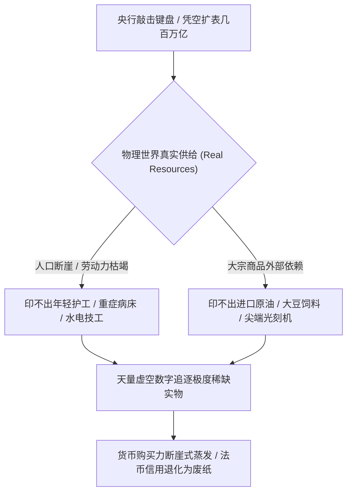
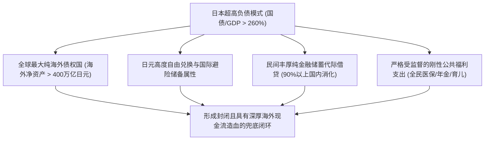

在宏观经济陷入债务承压与流动性停滞时，坊间常有一种近乎神化的论调：“拥有主权发钞权的政府在名义上永远不会破产。既然钱就是央行电脑里的一串数字，只要愿意用现代货币理论（MMT），再发三百万亿内债又有何不可？通胀与通缩丝毫不影响国家机器继续收割。”

这种观点看似深谙政治权力的霸道，实则彻底混淆了**记账符号（法币信用）**与**物理世界真实资源分配（劳动力、能源、粮食、生产力）**的本质鸿沟。

结合温铁军在《新中国十次周期性经济危机》中对历次信贷超发诱发恶性通胀与外汇枯竭的历史梳理，便能看清：新中国七十余年的经济史，本质上就是一部**试图依靠名义信用扩张掩盖实体赤字、最终被客观物理与外部硬通货规律残酷打脸的真实教训史**。

---

### 一、 温铁军历史实证：信贷超发掩盖实体赤字的两次崩盘

MMT 的鼓吹者常以为“印钞兜底”是当代高阶金融的创举。然而，新中国历史上早已做过两次极端的压力测试，结果无一例外走向了惨烈硬着陆：

```mermaid
flowchart TD
    subgraph 1988年第四次经济危机 (价格闯关与通胀海啸)
        A["80年代中后期财政赤字承压"] --> B["央行大水漫灌 / 试图通过信贷超发化解双轨制价格摩擦"]
        B --> C["名义货币脱离实体物资供给能力"]
        C --> D["全国性恶性通胀爆发 (CPI达18.8%) / 银行挤兑与生活物资抢购潮"]
    end

    subgraph 1993年第五次经济危机 (金融过热与汇率断崖)
        E["1992年南巡后地方盲目铺摊子开发区"] --> F["银行违规拆借 / 货币信贷超速膨胀 (M2增速超35%)"]
        F --> G["实体外汇储备逼近枯竭 / 进口通胀失控"]
        G --> H["1994年被迫实施硬着陆: 人民币官方汇率断崖贬值 (5.8跌至8.7)"]
    end
```

温铁军在书中明确指出：
1. **1988年价格闯关的本质教训**：当工业生产力与消费物资供给不足时，试图通过扩大货币供应量来“硬冲关”，结果直接引爆了建国以来最严重的恶性抢购风潮与金融挤兑，重创了执政信誉；
2. **1993年金融过热的汇率惨败**：地方大搞开发区、海南房地产泡沫狂飙，全靠银行信贷无锚兜底。最终结果是国家外汇储备消耗殆尽，迫使朱镕基铁腕压缩信贷，并在1994年实行汇率并轨、将人民币对美元从 5.8 官方汇率直接断崖贬值到 8.7。

**历史早已明证：名义印钞可以改写账本数字，但绝对创造不出真实的钢筋水泥、外汇硬通货与消费品供给。**

---

### 二、 央行印不出“年轻的劳动力与实物产出”

货币的本质，是国家强制法偿力所赋予的**“对全社会剩余劳动与产品的一纸即时索取权”**。



当老龄化达到峰值、出生率发生断崖式暴跌时：
1. 财政部与央行确实可以通过敲击键盘，将社保与退休金账户从每月 3000 元改成 30000 元甚至更高，在记账上做到“足额兑付、绝不违约”；
2. **但央行印不出护工、印不出医院病床、印不出粮食化肥，也印不出能下井维修城市供水管网的青年工人**；
3. 当全社会能够提供真实劳务与实物产出的青年人口发生不可逆的萎缩时，过量的“数字纸币”去追逐稀缺的劳务和物资，其结果必然是购买力的断崖式蒸发。

在经济学物理尺度上，这叫**触碰了全要素生产率与物理产能的刚性天花板**。此时继续印钞，数字不仅不能用于宏观调控，反而会摧毁整个法币的清偿信用。

这正如中国人民大学翟东升教授在《货币、权力与人：全球货币与金融体系的民本主义政治经济学》（中国社会科学出版社，2019年）中所深入剖析的：**现代货币并非冰冷中性的记账工具，而是主权权力的延伸与社会利益再平衡的利刃**。现代货币理论（MMT）主张“拥有法定发钞权的主权政府绝不破产”，但这一假设成立的前提是信用扩张必须锚定微观人本福祉与有效生产力。如果主权信贷的扩张权力脱离了微观家庭的资产负债表与人力资本积累，仅仅沦为官僚体系维持僵尸资产、掩盖坏账与特权寻租的兜底工具，那么天量注水非但无法激活内生需求，反倒会迅速诱发要素价格扭曲，使得初次分配恶性向权力与重资产倾斜，最终彻底锁死在凯恩斯式的“流动性陷阱”与实物供给枯竭中。

---

### 三、 为什么说“通胀与通缩不影响收割”存在致命死穴？

统治者确实可以通过通胀（铸币税）或通缩（压低要素成本）来调配社会财富，但这套收割机制在现代开放经济体中存在两道不可跨越的铁壁：

```text
+-------------------------------------------------------------------------+
|                  无锚印钞在通胀与通缩端遭遇的双重死穴                   |
+-------------------+-----------------------------------------------------+
| 路径              | 运行机制                      | 遭遇的系统性硬约束  |
+-------------------+-------------------------------+---------------------+
| 路径 A: 通胀收割  | 央行无限印钞注水，稀释存量储蓄| 击穿汇率堤坝，进口能源大豆价格暴涨，|
| (大水漫灌)        | 试图通过铸币税填补财政赤字    | 恶性输入型通胀瞬间摧毁制造业利润    |
+-------------------+-------------------------------+---------------------+
| 路径 B: 通缩收割  | 害怕汇率崩盘不敢直接印钞，    | 名义债务绝对刚性，企业居民倒闭法拍，|
| (资产负债表衰退)  | 任由资产负债表陷入被动收缩    | 抵押品腰斩，银行堆满坏账，收割边际归零|
+-------------------+-------------------------------+---------------------+
```

#### 1. 通胀收割的死穴：汇率堤坝与外部生命线
- 中国不是资源完全自给自足的封闭庄园：年进口原油超 5 亿吨（对外依存度超 70%）、大豆超 1 亿吨（超 80%），关键工业母机、先进制程芯片、铜铝矿石高度依赖国际大宗采购；
- 国际卖家只认能在全球自由购买真实物资的硬通货（美元、黄金），绝不接受在国内无限加零的人民币。一旦无节制注水打垮离岸在岸汇率，恶性输入型通胀会瞬间击穿基础民生底线，甚至连化肥、饲料与工业口粮都买不起。

#### 2. 通缩收割的死穴：债务链条的刚性锁死
- 地方城投、民营企业与居民房贷的债务规模是**绝对刚性的名义数字**；
- 通缩意味着物价下跌、企业营收缩水、居民降薪。分母上的收入在收缩，分子上的债务因通缩变得越来越沉重；
- 此时想收割，企业直接倒闭清算，居民直接“断供、法拍、躺平”。法拍房无人接盘，抵押品价值腰斩，银行系统堆满死账。**当收割对象直接变成破产主体时，收割的边际收益为零，甚至会引发金融系统的连锁爆雷。**

---

### 四、 为什么日本能维持超高内债，而中国不能照搬？

日本政府负债率常年超过 GDP 的 260%，央行疯狂买国债压低利率（YCC），表面上看似乎实现了“无限印钞兜底而社会风平浪静”的 MMT 奇迹。

但为什么日本能这么玩，而其他国家一旦照搬“直接发几百万亿”，后果会完全不同？因为日本模式能维持几十年不爆雷，背后依赖着四个极其苛刻的特殊前提：



1. **庞大的海外净资产“金山”**：日本连续三十多年稳坐全球最大净债权国宝座，海外净资产常年超过 400 万亿日元。日本跨国企业与财团在全球拥有海量矿山、工厂与优质股权，每年通过“海外二次投资”躺着收回巨额硬通货利息与分红；
2. **日元自由兑换与避险属性**：日元是高度自由兑换的国际通用结算货币，国际资本长期将其视作全球避险资产之一；
3. **资金绝大部分由国内储蓄消化**：日本国债 90% 以上由本土养老金、保险与银行持有，实质是**借用战后几代人积累的庞大民间私有净财富**。而中国居民近 70% 的财富死锁在流动性极差且持续缩水的房地产上，负债率极高，缺乏足额的金融净储蓄池来承接天量内债；
4. **资金流向的根本差异**：在日本透明预算与外部司法监督下，发债资金大头被死死限制在**全民养老金、高水平医保与公共安全网**中，直接转化为社会的刚性底线；而在缺乏透明制衡的系统里，天量信贷只会沿着权力管道流向无效基建、暗箱分包与离岸洗钱。

---

### 五、 从俄罗斯石油外汇流向看货币出海的三层分水岭

在探讨人民币出海时，有人常以中俄能源贸易为据，认为“只要有资源买卖，人民币就能成为世界货币”。

然而，透过俄罗斯央行（CBR）与莫斯科交易所（MOEX）的真实资金结算流向，恰恰可以看清国际货币在**“贸易结算”**与**“终极资产储备”**之间的本质代差：

```text
+-------------------------------------------------------------------------+
|                        国际货币出海的三层功能演进分水岭                 |
+-------------------+-----------------------------------------------------+
| 层级              | 核心功能                      | 当前人民币所处位置  |
+-------------------+-------------------------------+---------------------+
| 第一层: 贸易提货凭证| 买方直接用于采购特定中国商品  | 已完全跑通，依托中国全产业链制造优势|
+-------------------+-------------------------------+---------------------+
| 第二层: 第三方网络| 纯第三方交易接受度 (如沙特买巴西)| 正在推进，但仍受离岸清算网络摩擦约束|
+-------------------+-------------------------------+---------------------+
| 第三层: 资产自由沉淀| 境外主体自愿长期锁仓，随时无阻| 核心瓶颈：资本管制、外汇管制与政策突变|
| 与无摩擦退出      | 碍自由兑换投资境内国债与股票  | 风险，使外部机构更将其视为提货通道  |
+-------------------+-------------------------------+---------------------+
```

- **真实资金流不是长期囤积**：在中俄能源贸易中，由于双边贸易极度不平衡（俄罗斯顺差巨大），俄罗斯企业与银行体系内部沉淀了大量花不出去的人民币流动性；
- **抛出、对冲与换锚**：
  1. 一部分用于采购中国汽车、机电与消费品（第一层兑现）；
  2. 但对第三方的走私元件与特种物资采购，国际卖家认的是阿联酋迪拉姆（AED）或黄金，俄罗斯必须在香港、迪拜等离岸市场折价将人民币换成硬资产；
  3. 俄罗斯央行为托底国内卢布汇率，按预算规则在莫斯科交易所持续净卖出人民币、换回卢布用于国内财政开销；
- 这充分说明：**“能用来买中国工业品”确实是人民币最硬的实物锚，但它目前承担的主要是避开制裁的“特许提货凭证与过桥通道”**。距离成为全球资本自愿长期沉淀、无需担忧突发行政文件锁死资金出入境的“终极无风险资产”，仍有极其深厚的制度与法治鸿沟。

在魏伦、翟东升等编著的《大国货币》（北京大学出版社，2015年）中，系统梳理了大国主权货币迈向国际化的三步演进规律：**“双边贸易结算计价 -> 国际投融资与大宗商品计价 -> 全球官方外汇储备货币”**。缺乏深度的本土金融资产蓄水池、可信的法治产权保护与自由资本账户，任何法定货币都无法直接跨越至第三阶段。

而在翟东升、嵇先白、魏子龙合著的《制裁与经济战：国力碰撞的大争之世，中国如何把握主动》（中国人民大学出版社，2025年）中更进一步指出：在面临西方金融制裁与二级长臂管辖的极端环境下，非西方大国之间的本币互换与替代清算往往伴随着高昂的跨国交易成本与汇率流动性贴水；如果离岸沉淀的货币无法顺畅对流回境内完成高价值资产配置，那么这种出海循环实质上只能扮演特定地缘冲击下的防守型“救生筏”，而远非重构全球金融秩序的进攻型“航空母舰”。

---

### 六、 结语

结合新中国十次周期性经济危机的惨痛教训，现代货币理论（MMT）无情地揭示了一条最质朴的经济物理学常识：

**货币只是对现实资源的指挥棒。**

当一个社会的年轻人熄灭了繁衍欲望、实体企业丧失了盈利造血能力、关键原材料深度依赖外部输入时，账面上的数字哪怕敲上再多的零，现实世界里也没有可以被指挥的乐团了。无视实体资源边界的无锚印钞，从来不是拯救危机的灵药，而只是通往法币信用崩溃的最快引信。

---

### 参考文献与延伸阅读

1. 温铁军. 新中国十次周期性经济危机[M]. 北京: 东方出版社, 2013.
2. 翟东升. 货币、权力与人: 全球货币与金融体系的民本主义政治经济学[M]. 北京: 中国社会科学出版社, 2019.
3. 魏伦, 翟东升, 等. 大国货币[M]. 北京: 北京大学出版社, 2015.
4. 翟东升, 嵇先白, 魏子龙. 制裁与经济战: 国力碰撞的大争之世, 中国如何把握主动[M]. 北京: 中国人民大学出版社, 2025.
