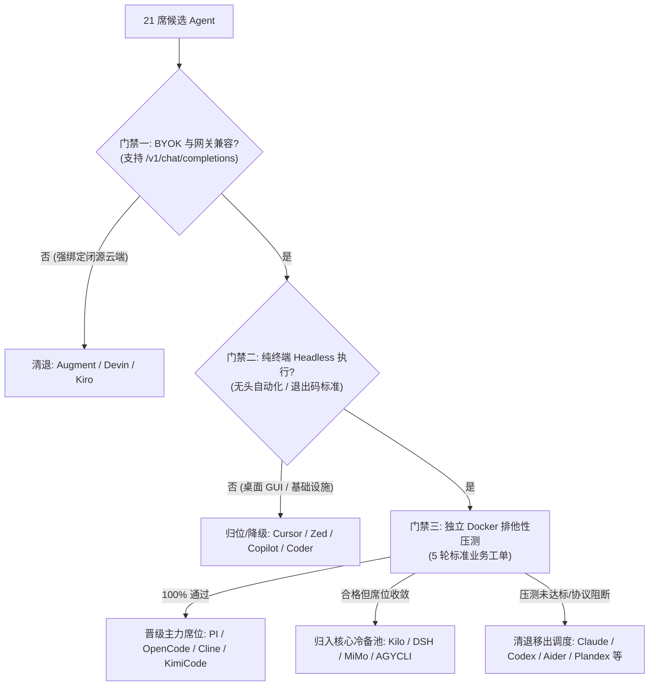
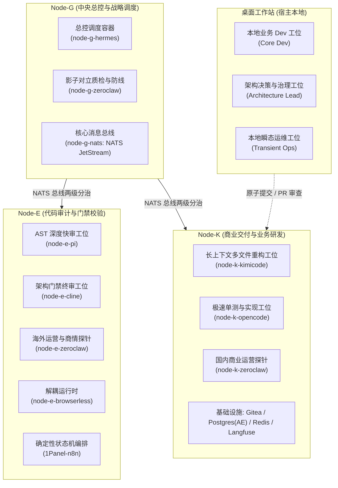

# Agent Teams 席位演进：21 款编码智能体选型实录

在多智能体（Multi-Agent System）协同开发体系中，工程团队往往面临一个典型的认知陷阱：**试图引入市场上所有流行的 Agent 工具，让每个 Agent 各司其职，最终导致容器数量爆炸、端口冲突频发、内存与 CPU 负载虚高，并带来灾难性的“人肉路由器”协调负担**。

为了彻底打破“盲目堆叠全量常驻 Agent”的困局，我们针对业界 21 款主流编码智能体展开了严格的架构归类与排他性 Docker Benchmark 压测，完成了从多智能体混战到“三大物理节点 9 核心席位 + 5 款核心冷备池”的去噪收敛。本文完整复盘这一选型方法论、基准压测数据及最终落地的集群架构拓扑。

---

## 1. 架构困境：多智能体系统的“容器膨胀病”

在集群演进早期，为了应对前端、后端、嵌入式、测试生成和代码重构等异构需求，系统先后纳入了 21 款工具与智能体候选。然而，全量常驻部署带来了显著的架构负债：

1. **资源空耗与悬挂进程**：常驻运行的容器争抢端口与系统内存，大量后台常驻进程因缺少任务流转而处于闲置监听状态，浪费边缘计算节点的硬件资源。
2. **规范互斥与契约割裂**：不同 Agent 依赖不同的调用规范，有的强依赖官方闭源云端，有的强制交互式终端输入，有的缺少明确的退出状态码，导致自动化编排与 CI/CD 流水线无法形成确定性闭环。
3. **“人肉路由器”死锁**：调度中枢无法用统一接口向不同 Agent 派发工单，人类开发者被迫充当上下文搬运工与命令翻译器，违背了自主自治的初衷。

为此，架构治理确立了核心原则：**活跃运行容器实施极致去噪收敛；绝大多数备选工具退回冷备池（Cold-Storage），实现日常零常驻、零挂载、按需激活**。

---

## 2. 选型准入框架：三大硬性工程门禁

在启动基准压测前，我们制定了三道不可逾越的准入红线，对 21 款候选对象执行结构化初筛：

### 门禁一：BYOK 与自建网关原生兼容（反闭源垄断）
- 必须原生支持 OpenAI 兼容契约（`/v1/chat/completions`）或自建网关，允许通过环境变量（`.env`）动态提取 API Key 与 Base URL。
- **一票否决**：强绑定官方闭源云端、强制专属商业账号或计费通道、不支持自定义 Provider 的工具一律直接清退。

### 门禁二：Headless 纯终端与无人值守自动化闭环
- 必须支持在无桌面环境的 Linux Docker 容器内非交互式（Non-Interactive / Headless）执行。
- 任务执行完毕必须返回标准语义退出码（Exit Code 0 表示成功，非 0 表示具体错误），单测通过与 Git 操作必须形成确定性状态，严禁出现阻塞等待按键交互的假死挂起。

### 门禁三：架构分治与代码证据审计支持
- 执行动作可度量、可溯源，支持原子小步提交与 AST 静态扫描，严禁擅自绕过门禁或进行不可逆的高危越权操作。

---

## 3. 候选全景归类与首轮初筛剥离

基于上述门禁，我们对 21 款候选工具进行了首轮架构定性与物理剥离：

### 3.1 闭源与官方云端强绑定组（3 款 -> 彻底清退）
| 工具名称 | 清退原因归因 | 最终处置 |
| :--- | :--- | :--- |
| **Augment Code (`auggie`)** | 强绑定 Augment Cloud 远程私有语义索引，无法接入自建网关与第三方大模型。 | **清退**：移出调度队列，杜绝数据外泄风险。 |
| **Devin CLI** | 强绑定 Cognition 官方商业计费与专属鉴权通道，不支持 BYOK 机制。 | **清退**：移出候选池。 |
| **Kiro CLI** | 强依赖 AWS Builder ID / IAM 认证并直连官方端点，官方版本无通用模型中继接口。 | **清退**：移出候选池。 |

### 3.2 架构外壳与定位错位组（4 款 -> 剥离归位）
| 工具名称 | 实际本质与技术特征 | 最终归位定位 |
| :--- | :--- | :--- |
| **Cursor CLI (`cursor`)** | 桌面 GUI 编辑器伴生外壳，在无桌面环境的 Linux 容器中无法运行无头渲染流程。 | **归位**：仅保留于开发者桌面宿主机，供本地人机交互。 |
| **Zed CLI (`zed`)** | 高性能 Rust 桌面编辑器外壳，缺少面向自动化的纯文本无头流式指令流。 | **归位**：仅保留于开发者桌面宿主机。 |
| **GitHub Copilot CLI** | 终端命令解释器，仅用于生成/解释单条 Shell 与 Git 命令，无跨文件工程重构能力。 | **降级**：转为桌面工作站瞬态运维辅助工具。 |
| **Coder CLI (`coder`)** | CDE (Cloud Development Environment) 平台编排工具，职责属于沙箱环境生命周期管理。 | **剥离**：移出 Agent 名单，归入底层容器基础设施。 |

---

## 4. 排他性 Docker Benchmark 实测数据

通过首轮剥离后，剩余 14+ 款纯终端 Headless 编码 Agent 进入客观压力测试。

### 4.1 压测环境与排他性执行机制
- **测试环境**：物理隔离测试节点（测试网络 `19.2.1.***`），测试算力基于 `deepseek/deepseek-v4.1-flash`。
- **排他性隔离策略**：为消除多容器并发对 CPU、磁盘 I/O 及网络带宽的争抢干扰，测试脚本执行严格的**单容器排他测试流程**——单个 Agent 启动执行 5 轮标准业务工单，完成后停止容器（不执行物理删除，保留状态核验），**强制休眠 15 秒冷却**后，再拉起下一个候选。
- **工单评测任务**：标准微服务模块功能开发，涵盖“代码检出 -> 接口实现 -> 异常捕获 -> 单元测试运行 -> Git 原子提交”，校验退出码、单测通过率与 Git 提交树合法性。

### 4.2 基准压测结果榜单

下表记录了各候选 Agent 在 5 轮排他性压测中的完整表现：

| 候选 Agent 标识 | 运行轮数 | 成功通过轮数 | 平均耗时 (ms) | 成功率 | 核心定性与表现归因 |
| :--- | :---: | :---: | :---: | :---: | :--- |
| **PI Coder** | 5 | 5 | 37,253 | **100%** | **最优响应**：极轻量镜像，单测驱动闭环极快，AST 扫描无缝协同。 |
| **OpenCode** | 5 | 5 | 45,319 | **100%** | **极速端侧**：对自建 OpenAI 兼容网关支持完美，业务代码生成精准。 |
| **Cline CLI** | 5 | 5 | 56,273 | **100%** | **自愈严谨**：自动化工具调用与重试逻辑成熟，适合作为严格门禁终审。 |
| **Kilo Code** | 5 | 5 | 60,315 | **100%** | **稳定轻量**：各轮次方差小，依赖极简，适合应急修复。 |
| **KimiCode** | 5 | 5 | 69,086 | **100%** | **长上下文重构**：多文件感知能力优异，跨模块逻辑重构表现稳健。 |
| **Claude Code CLI** | 5 | 0 | - | 0% | **协议阻断**：底层强依赖 Anthropic `/messages` 协议，向 `/v1/chat/completions` 自建网关转发时方言解析失败。 |
| **Codex CLI** | 5 | 0 | - | 0% | **沙箱受限**：依赖 bubblewrap 等低层 Linux 命名空间容器特权，在标准隔离容器内执行失败。 |
| **Aider** | 5 | 0 | - | 0% | **交互阻塞**：非交互式 batch mode 下因终端交互确认与 Git 配对提示阻塞，未能实现无人值守闭环。 |
| **DSH (DeepSeek Harness)** | 5 | 0 | - | 0% | 环境探针配置偏差，转入冷备调优。 |
| **Plandex** | 5 | 0 | - | 0% | 缺少面向单模块自动修复的非交互式管道，执行超时。 |
| **Qoder CLI** | 5 | 0 | - | 0% | 缺少标准退出契约与自愈单测执行流。 |
| **MiMo Code** | 5 | 0 | - | 0% | 端侧代码模型接口适配不全，转入冷备。 |
| **MiniMax Code CLI** | 5 | 0 | - | 0% | 无头环境下工具调用丢失上下文。 |
| **Gemini CLI** | 5 | 0 | - | 0% | 命令行端点适配不全，超时未完成。 |
| **OpenHands** | 5 | 0 | - | 0% | 平台型重型容器底座启动过重，不匹配轻量 Worker 契约。 |
| **AGY CLI Coder** | 5 | 0 | - | 0% | 执行流配置偏差，收敛至冷备归档。 |

---

## 5. 架构收敛：三大节点 9 核心席位与 5 款冷备池

根据压测实测数据与职责分工，全集群活跃运行容器实施了彻底的收敛治理。

### 5.1 活跃席位矩阵（九大核心角色分布）

1. **桌面工作站 (3 个工程席位，宿主本地无多余常驻容器)**：
   - **本地业务 Dev 席位**：承担本地业务写码、单元测试驱动开发与小步 Git 原子提交；
   - **技术架构与规约治理席位**：承担跨域技术方案审查、ADR 架构决策定版与契约治理；
   - **本地瞬态运维探活席位**：仅在必要时临时唤醒，执行预授权白名单内的只读探活与巡检提请。
2. **Node-G 中央总控节点 (2 容器，3 角色)**：
   - `node-g-hermes`：总控调度中枢，负责任务评估、两级分治派发与跨信道状态汇总；
   - `node-g-zeroclaw`：运行影子对立质检与红军预警防线；
   - 基础设施：`node-g-nats`（NATS JetStream 核心消息总线）。
3. **Node-E 双轨审计与编排节点 (3 容器，3 角色)**：
   - `node-e-pi`：代码全量快审（压测冠军，负责极速 AST 扫描与语法缺陷筛查）；
   - `node-e-cline`：架构契约与门禁终审（压测第三名，负责逻辑一致性与客观门禁把关）；
   - `node-e-zeroclaw`：海外趋势与商情监测探针；
   - 解耦运行时：`node-e-browserless`（无头浏览器 RPA）与 `1Panel-n8n`（状态机编排）。
4. **Node-K 商业交付与研发节点 (3 容器，3 角色)**：
   - `node-k-kimicode`：长上下文多文件代码重构；
   - `node-k-opencode`：极速功能研发与单测开发；
   - `node-k-zeroclaw`：国内商业化运营与线索捕获；
   - 基础设施：Gitea（代码主仓）、PostgreSQL（`AE` 记忆库）、Redis、Langfuse。

### 5.2 核心冷备工位池 (5 款精简冷备契约)

经过排他性压测与架构评估，仅保留 5 款高质量工具进入**核心冷备工位池（Cold-Storage Standby Registry）**：

| 序号 | 标识与名称 | 核心定位与技术栈 | 瞬态拉取与安装契约 (Cold-Install Contract) |
| :---: | :--- | :--- | :--- |
| 1 | `kilocode (Kilo Code)` | 压测满分候选，轻量级应急修复 Worker | 预置沙箱镜像归档 |
| 2 | `dsh (DeepSeek Harness)` | DeepSeek 体系代码开发与基准评测 | 预置沙箱镜像归档 |
| 3 | `commandcode (CommandCode CLI)` | 多工具代码全量审计与执行工位 | 预置沙箱镜像归档 |
| 4 | `MiMoCLI (MiMo Code)` | 小米端到端端侧代码模型 CLI | `curl -fsSL https://mimo.xiaomi.com/install \| bash` |
| 5 | `AGYCLI (AGY CLI)` | 多模块系统工程与自愈执行工位 | 预置沙箱镜像/脚本归档 |

**冷备运行准则（Cold-Storage Policy）**：
- **日常物理零常驻**：三节点宿主机严禁保留冷备 Agent 的常驻运行容器与闲置悬挂镜像（零端口监听、零内存挤占、零磁盘开销）；
- **按需瞬态拉起**：仅当主力工位发生模型配额熔断、特定语言生态必须适配或严重故障时，经架构授权后临时拉起瞬态沙箱，**任务交付验收后立即销毁容器并清理镜像**。

---

## 6. 总结与方法论启示

多智能体系统的本质不是“凑齐所有流行的 Agent”，而是**在有限的边缘与云端算力下，构建确定性、解耦且具备高容错能力的生产流水线**。

通过本次从 21 款工具到 9 活跃席位 + 5 款冷备池的收敛演进，我们获得了三条核心工程启示：

1. **客观数据胜于主观评级**：工具的表现不取决于其在社交媒体上的热度，而取决于其在标准无头容器内的退出码确定性、网络兼容性与单测通过率。
2. **架构收敛带来系统稳定**：容器数量减少 60% 以上后，节点端口冲突彻底消除，消息路由拓扑完全确定，系统可观测性与可用性显著提升。
3. **动态冷备实现资源弹性**：通过冷备池与瞬态拉取契约，既保证了极端故障场景下的容灾替补能力，又实现了日常运行环境的极致轻量与整洁。

---

## 免责声明

1. **测试基准与环境限定**：本文所涉及的 Docker 排他性基准测试（Benchmark）、耗时统计、单测通过率及各模型/CLI 表现，均基于特定测试节点的受控硬件、网络拓扑与指定版本模型网关实测得出，仅代表特定工程工单下的适配效果，不构成对任何开源项目或商业产品的通用技术评价或官方背书。
2. **架构中立性说明**：文中所涉及的节点划分、容器角色命名及职责分工，均为纯粹面向工程解耦与权限安全设计的逻辑模型，不包含任何外部宣称或人格化意图。
3. **选型演进与业务适配**：多智能体技术与开源工具链迭代迅速，文中所涉架构决策、冷备池契约及分工设计仅供技术团队参考与交流，团队在实际落地中应结合自身业务场景、合规要求与基础设施条件自主决策。
